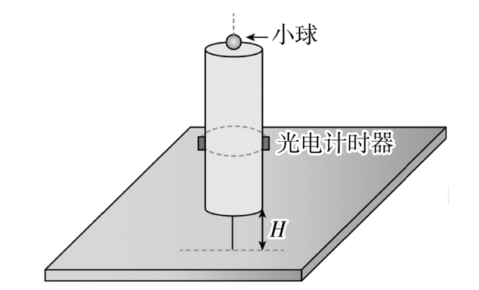

# Physics - 题目 1877

**ID**: bf79619fb38444698696120d25f823cc
**年级**: Grade 10
**难度**: Medium-Hard
**题型**: 分，共42分，要求有必要的文字说明）

## 题目
（16分）如图所示，有一空心上下无底的弹性圆筒，它的下端距水平地面的高度为 $H$ （已知量），筒的轴线竖直。​​​​​​​‌圆筒轴线上与筒顶端等高处有一弹性小球，现让小球和圆筒同时由静止自由落下，圆筒碰地后的反弹速率为落地速率的 $\frac{4}{5}$ ， 小球碰地后的反弹速率为落地速率的 $\frac{9}{10}$ ， 它们与地面的碰撞时间都极短，可看作瞬间反弹，运动过程中圆筒的轴线始终位于竖直方向。已知圆筒第一次反弹后再次落下，它的底端与小球同时到达地面（在此之前小球未碰过地），此时立即锁住圆筒让它停止运动，小球则继续多次弹跳，重力加速度为 $g$ ， 不计空气阻力，求：（1）圆筒第一次落地弹起后相对于地面上升的最大高度 ${h}_{\mathrm{\max }}$ ；（2）小球从释放到第一次落地所经历的时间 $t$ 以及圆简的长度 $L$ ；（3）在筒壁上距简底 $\frac{L}{2}$ 处装有一个光电计数器，小球每次经过该处计数器就会计数一次，请问，光电计数器的示数最终稳定为几次？

## 解答

1. （1）圆筒第一次落地做自由落体运动，有 $2{gH}={v}_{筒}^{2}$ （2分）
2. 圆筒第一次落地弹起后到最高点做匀减速运动，可视为初速度为零的匀加速运动，有
3. $2g{\text{h}}_{\mathrm{\max }}={\left(\frac{4}{5}{v}_{筒}\right)^{2}}$  （2分）
4. 联立解得 ${\text{h}}_{\mathrm{\max }}=\frac{16}{25}H$ （2分）
5. （2）根据 $\text{h=}\frac{1}{2}g{t}^{2}$ 可得圆筒第一次落地的时间 ${t}_{1}=\sqrt{\frac{2H}{g}}$ . （1分）
6. 圆筒第一次弹起后到最高点的时间 ${t}_{2}=\sqrt{\frac{2{\text{h}}_{\mathrm{\max }}}{g}}=\frac{4}{5}\sqrt{\frac{2H}{g}}$ 。。。。 （1分）
7. 圆筒第一次弹起后到落地时小球同时到达地面，所以小球从释放到第一次落地所经历的时间
8. $t={t}_{1}{+2}{t}_{2}=\sqrt{\frac{2H}{g}}{+2×}\frac{4}{5}\sqrt{\frac{2H}{g}}=\frac{13}{5}\sqrt{\frac{2H}{g}}.$  （1分）
9. 可知小球下落的高度 $\text{h=}\frac{1}{2}g{t}^{2}=\frac{169}{25}H$  （1分）
10. 则圆筒的高度 $L\text{=h-}H=\frac{144}{25}H$ （1分）
11. （3）小球第一次落地时的速度 $v=\sqrt{2g\text{h}}=\frac{13}{5}\sqrt{2{gH}}$ （1分）
12. 小球反弹后能到达筒壁上距筒底 $\frac{L}{2}$ 处的速度 ${v}^{\prime }=\sqrt{2g\frac{L}{2}}=\frac{6\sqrt{2}}{5}\sqrt{2{gH}}$ . （1分）
13. 设小球最后到达距筒底 $\frac{L}{2}$ 处与地共碰撞 $n$ 次，小球每次碰地后的反弹速率为落地速率的 $\frac{9}{10}$ ， 则有 $v×{\left(\frac{9}{10}\right)^{n}}>{v}^{\prime }$ （1分）
14. 解得 $n{=4}$ 次… （1分）
15. 则光电计数器的示数最终稳定为 $2n{+1=9}$ 次…（1分）

## 知识点

**中文**:
  - 自由落体运动和竖直上抛运动的相遇问题

**English**:
  - Encounter Problems: Free Fall and Vertical Throw

---
