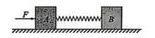

# Physics - 题目 1269

**ID**: 027b75f05c82474aab7bce6fab331477
**年级**: Grade 10
**难度**: Medium-Hard
**题型**: 单项选择题

## 题目
如图所示，木块 $A、B$ 质量分别为 $\text{3 kg}$ 和 $\text{5 kg}$ ，它们与水平地面间的动摩察因数均为0.2，最大静摩擦力等于滑动摩擦力。​​​​​​​‌初始状态 $A、B$ 间的轻弹簧校压缩了 $\text{4 cm}$ ，作用在 $A$ 上的水平推力 $F\text{=12 N}$ 系统静止不动。已知弹簧的劲度系数为 ${200}\text{N}\text{/m}，$ 重力加速度 $g$ 取 ${10/}{\text{m}}^{2}$ .现撤去推力 $F$ （撒去推力 $F$ 瞬间，可认为弹簧弹力保持不变），则（      ）

## 解答

1. $A$ 的最大静摩擦力 ${f}_{\text{Am}}=\mathit{\mu }{m}_{A}g\text{=0.2×3×10 N=6 N}$ ，弹簧的弹力 ${F}_{弹}={kx}{=200×4×1}{0}^{-2}\text{ N=8 N}$ ，由题知 $F\text{=12 N<}{F}_{弹}+{f}_{\text{Am}}\text{=14 N}$ ，故 $A$ 处于静止状态，则有 ${f}_{A}=F-{F}_{弹}\text{=12 N-8 N=4 N}$ ，方向向左， $A$ 错误； $B$ 的最大静摩擦力 ${f}_{\text{Bm}}=\mathit{\mu }{m}_{B}g\text{=0.2×5×10 N=10 N}$ ，由题知 ${F}_{弹}\text{=8 N<}{f}_{\text{Bm}}\text{=10 N}$ ，故 $B$ 处于静止状态，则有 ${f}_{B}={F}_{弹}\text{=8 N}$ ，方向向左，B错误；撤去推力 $F$ 后瞬间，弹簧的弹力不变，仍为 ${F}_{弹}\text{=8 N}$ ，大于 $A$ 的最大静摩擦力，可知 $A$ 会滑动，故 $A$ 受到的摩擦力为滑动摩擦力， ${f}_{A}^{\prime }={f}_{Am}\text{=6 N}$ ，方向向右，由牛顿第三定律可知，地面受木块 $A$ 的摩擦力大小是 $\text{6 N}$ ，方向向左， $C$ 正确；撤去推力 $F$ 后瞬间，弹簧的弹力不变，仍为 ${F}_{弹}\text{=8 N}$ ，小于 $B$ 的最大静摩擦力，可知 $B$ 仍处于静止状态，对 $B$ 分析，可得木块 $B$ 所受摩擦力大小为 ${F}_{弹}^{\prime }={F}_{弹}\text{=8 N}$ ，方向向左，由牛顿第三定律可知，地面受木块 $B$ 的摩擦力大小为 $\text{8 N}$ ，方向向右，D错误。

## 知识点

**中文**:
  - 弹力的大小与胡克定律
  - 滑动摩擦力的判断与计算
  - 牛顿第三定律的应用

**English**:
  - Magnitude of Elastic Force and Hooke's Law
  - Determination and Calculation of Sliding Friction
  - Applications of Newton's Third Law

---
