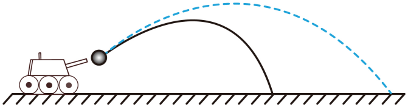

# Physics - 题目 1409

**ID**: 15b4d1b6f72b4726a1592631fabfe7ce
**年级**: Grade 10
**难度**: Medium-Hard
**题型**: Multiple-choice

## 题目
在实际情况中，物体做抛体运动时总会受到空气阻力的影响。​​​​​​​‌如图所示，虚线是炮弹在忽略空气阻力情况下计算出的飞行轨迹；实线是炮弹以相同的初速度和抛射角射出在空气中实际的飞行轨迹，这种曲线叫作弹道曲线。由于空气阻力的影响，弹道曲线的升弧和降弧不再对称，升弧长而平伸，降弧短而弯曲。炮车的大小可以忽略。当炮弹做弹道运动时，结合学过的力学知识，分析判断下列说法正确的是（      ）

## 解答

1. A．炮弹上升过程中，在竖直方向上，受到重力和阻力在竖直向下的分力，即
2. $mg+f{{}_{1}}=ma{{}_{y1}}$
3. 解得
4. $a{{}_{y1}}=\frac {mg+f{{}_{1}}}{m}$
5. 炮弹下降过程中，在竖直方向，受到向下的重力和阻力在竖直向上的分力，即
6. $mg-f{{}_{2}}=ma{{}_{y2}}$
7. 解得
8. $a{{}_{y2}}=\frac {mg-f{{}_{2}}}{m}$
9. 则
10. $a{{}_{y1}}>a{{}_{y2}}$
11. 设炮弹上升的时间为 $t{{}_{1}}$ ，炮弹下降的时间为 $t{{}_{2}}$ ，根据
12. $h=\frac {1}{2}a{{}_{y1}}t{{}_{1}}{^{2}}$
13. $h=\frac {1}{2}a{{}_{y2}}t{{}_{2}}{^{2}}$
14. 得
15. $t{{}_{1}}<t{{}_{2}}$
16. 炮弹上升的时间一定小于下降的时间。A错误；
17. B．到达最高点时，除受竖直向下的重力外还受到水平方向的空气阻力作用 $f$ ，合力
18. $F{{}_{合}}=\sqrt {（mg）{^{2}}+f{^{2}}}>mg$
19. 由牛顿第二定律可知，炮弹在最高点时的加速度大于重力加速度。B错误；
20. C． 假设空气阻力大小不变，由微元法，上升过程克服空气阻力做的功等于空气阻力与上升过程路程的乘积，下降过程克服空气阻力做的功等于空气阻力与下降过程路程的乘积。升弧长而平伸，降弧短而弯曲。上升过程克服空气阻力做的功大于下降过程克服空气阻力做的功。又由功能关系，克服空气阻力做的功等于机械能的减少量。炮弹在上升阶段损失的机械能大于在下降阶段损失的机械能。
21. 假设空气阻力大小与速度成正比或与速度的平方成正比，由于空气阻力始终做负功，同一高度处，上升过程的速度大小总是下降过程的速度大小，则同一高度处，上升过程的空气阻力大小总是大于下降过程的空气阻力大小。由微元法，上升过程克服空气阻力做的功等于空气阻力与上升过程路程的乘积，下降过程克服空气阻力做的功等于空气阻力与下降过程路程的乘积。升弧长而平伸，降弧短而弯曲。上升过程克服空气阻力做的功大于下降过程克服空气阻力做的功。又由功能关系，克服空气阻力做的功等于机械能的减少量。炮弹在上升阶段损失的机械能大于在下降阶段损失的机械能。
22. C正确。
23. D．炮弹在上升阶段重力势能的增加量等于在下降阶段重力势能的减少量。D错误。选C。

## 知识点

**中文**:
  - 单一物体机械能守恒定律的应用

**English**:
  - Applications for Single Body

---
