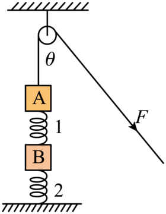

# Physics - 题目 2601

**ID**: 1a4fd6e5d8694828b513e3a73f771c87
**年级**: Grade 10
**难度**: Medium-Hard
**题型**: Multiple-choice

## 题目
如图所示，A、B两木块质量均为m，1、2两轻弹簧的劲度系数分别为 $k{{}_{1}}$ 、 $k{{}_{2}}$ ，轻绳绕过不计大小的光滑定滑轮与A相连，弹簧与木块、地面均拴接，整个系统静止，滑轮左侧绳子刚好保持竖直，重力加速度为g。​​​​​​​‌现用力F缓慢拉绳，拉动时滑轮右侧绳子保持与竖直方向的夹角为 $θ$ ，直到2弹簧弹力大小变为原来的一半为止，在这一过程中，下列说法错误的是（      ）

## 解答

1. AB．根据胡克定律可得，原来1弹簧的压缩量为 $x{{}_{11}}=\frac {mg}{k{{}_{1}}}$ ，弹簧2的压缩量为 $x{{}_{21}}=\frac {2mg}{k{{}_{2}}}$ ，若2弹簧弹力大小变为原来的一半且2弹簧处于压缩状态，则此时2弹簧的压缩量为 $x{{}_{22}}=\frac {1}{2}x{{}_{21}}=\frac {mg}{k{{}_{2}}}$ ，对B分析可得 $mg=k{{}_{2}}x{{}_{22}}$ ，所以1弹簧刚好恢复原长，此过程中A木块上升的位移为 $Δx=x{{}_{11}}+\left ({x{{}_{21}}-x{{}_{22}}}\right )=\frac {mg}{k{{}_{1}}}+\frac {mg}{k{{}_{2}}}$ ，若2弹簧弹力大小变为原来的一半且2弹簧处于伸长状态，则此时2弹簧的伸长量为 $x^{′}{{{}_{22}}}=\frac {1}{2}x{{}_{21}}=\frac {mg}{k{{}_{2}}}$ ，对B分析可得 $mg+k{{}_{2}}x^{′}{{{}_{22}}}=k{{}_{1}}x^{′}{{{}_{12}}}$ ，所以1弹簧的弹力为 $2mg$ ，此时1弹簧的伸长量为 $x^{′}{{{}_{12}}}=\frac {2mg}{k{{}_{1}}}$
2. 此过程中A木块上升的位移为 $Δx^{′}=x{{}_{11}}+x{{}_{21}}+x^{′}{{{}_{21}}}+x^{′}{{{}_{12}}}=\frac {3mg}{k{{}_{1}}}+\frac {3mg}{k{{}_{2}}}$ ，A错误，B正确；
3. CD．若2弹簧弹力大小变为原来的一半且2弹簧处于压缩状态，对A分析可得绳子的拉力为 $F=mg$ ，绳子对定滑轮的作用力大小 $F{{}_{滑}}=2F{\cos}\frac {θ}{2}=2mg{\cos}\frac {θ}{2}$ ，若2弹簧弹力大小变为原来的一半且2弹簧处于伸长状态，对A分析可得绳子的拉力为 $F^{′}=3mg$ ，绳子对定滑轮的作用力大小 $F^{′}{{{}_{滑}}}=2F^{′}{c}os\frac {θ}{2}=6mg{\cos}\frac {θ}{2}$ ，C、D正确。本题选择错误的，选A。

## 知识点

**中文**:
  - 力的平行四边形定则与三角形定则
  - 弹力的大小与胡克定律

**English**:
  - Parallelogram Rule and Triangle Rule for Forces
  - Magnitude of Elastic Force and Hooke's Law

---
