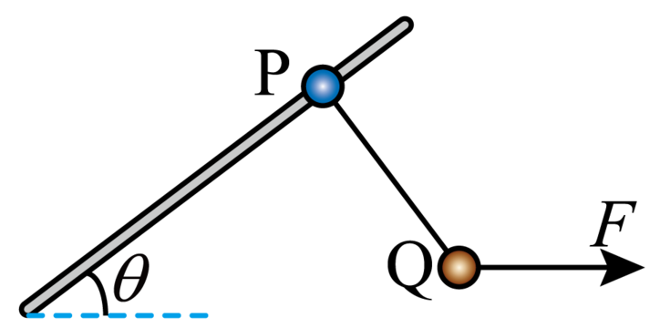

# Physics - 题目 1524

**ID**: 2160533033cd48ac80d1ce9c6c78185e
**年级**: Grade 10
**难度**: Medium-Hard
**题型**: Multiple-choice

## 题目
如图所示，倾角为θ的固定细杆上套有一小球P，小球P可以沿细杆滑动，另一个小球Q通过轻质细线与小球P连接，当对小球Q施加一个水平向右的作用力 $F$ 时细线恰好与细杆垂直，两小球均处于静止状态。​​​​​​​‌已知两小球的质量相同，重力加速度为 $g$ ，最大静摩擦力等于滑动摩擦力，则小球P和细杆之间动摩擦因数的最小值为（      ）

## 解答

1. 如图所示，对Q根据平衡条件可得
2. $T=\frac {mg}{{\cos}θ}$
3. 对P同理可得
4. $f=mg{\sin}θ$
5. 由题意可知
6. $f\leqslant f{{}_{{\rm{m}}}}=μN=μ(mg{\cos}θ+T)$
7. 联立以上各式解得
8. $μ\geqslant \frac {{\sin}θ{\cos}θ}{{\cos}{^{2}}θ+1}$
9. 故选A。
10. 

## 知识点

**中文**:
  - 受力分析
  - 正交分解法与三角形定则在平衡问题中的应用

**English**:
  - Force Analysis
  - Orthogonal Decomposition and Triangle Rule in Equilibrium

---
