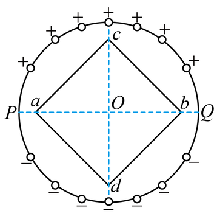

# Physics - 题目 1638

**ID**: 269194dc52144eacb1600bc86018b7c7
**年级**: Grade 10
**难度**: Medium-Hard
**题型**: Multiple-choice

## 题目
如图所示，竖直面内一绝缘细圆环，关于水平直径PQ上下对称各镶嵌7个电荷量相等的正、负点电荷，上边为正，下边为负，在竖直直径上各有一个正负电荷，其余6个正、负电荷关于竖直直径对称。​​​​​​​‌a、b、c、d分别为水平和竖直直径上的四个点，四点连线构成一正方形，圆心O位于正方形的中心。则以下说法正确的是（      ）

## 解答

1. 因为关于O点上下对称的两等量异种电荷在ab两点产生的场强都相等，根据场强叠加，结合对称性可知，a、b两点的场强相等，方向均垂直于PQ向下，选项A错误；由于ab连线上电场方向都向下，ab连线为等势线，所以B正确；因关于O点左右对称的两等量异种电荷在cd两点产生的场强都相等，由叠加原理可知，c、d两点的场强相同，选项C错误；因c点距离正电荷较近，d点距离负电荷较近，可知c点电势高于d点的电势，选项D错误。

## 知识点

**中文**:
  - 非点电荷的电场强度的计算与叠加

**English**:
  - Calculation and Superposition of Non-Point Charge Fields

---
