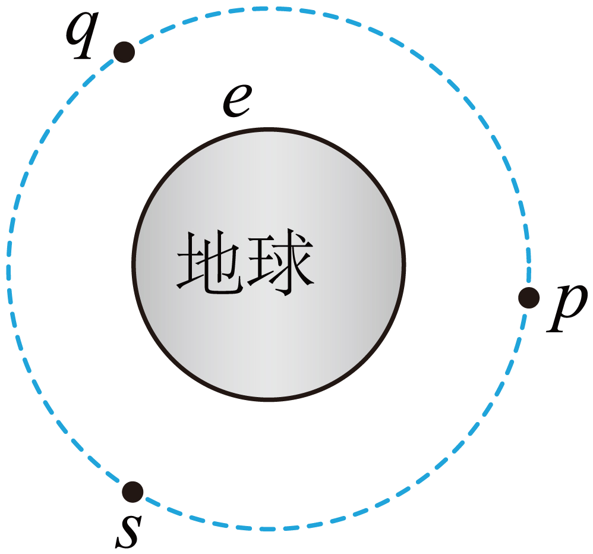

# Physics - 题目 497

**ID**: 4228e03417e04fc6a84c149865d87ecd
**年级**: Grade 10
**难度**: Medium-Hard
**题型**: Multiple-choice

## 题目
如图所示，e为地球赤道上的一栋建筑物，p、q、s为同一轨道上等间距分布的三颗地球卫星，它们恰好实现对赤道的全覆盖；f是地球同步通信卫星（图中未画出），它的轨道半径约为地球半径的6.6倍，地球半径为R。​​​​​​​‌所有卫星均在赤道平面上绕地心沿逆时针方向做匀速圆周运动。下列说法正确的是（      ）

## 解答

1. p、q、s三颗卫星恰好实现对赤道的全覆盖，则它们的位置关系如图所示
2. 
3. 由几何关系可知三颗卫星的轨道半径为 $2R$ ，所以卫星q距离地面的高度为 $R{\rm ，A}$ 错误；根据开普勒第三定律有 $\frac {(6.6R){^{3}}}{T{{}_{0}^{2}}}=\frac {(2R){^{3}}}{T{^{2}}}$ ，其中静止卫星的周期为 $T{{}_{0}}=24{\rm{h}}$ ，联立解得卫星p的周期大约为 $T=4{\rm{h}}{\rm ，B}$ 错误；根据万有引力提供向心力可得 $\frac {GMm}{r{^{2}}}=m\frac {v{^{2}}}{r}$ ，可得 $v=\sqrt {\frac {GM}{r}}$ ，由于p、q、s三颗卫星的轨道半径相同，则p、q、s的速度之比为 $1:1:1{\rm ，C}$ 错误；若某时刻p在f的正下方，设经过 $t$ 时间，s在f的正下方，则有 $(\frac {2π}{T}-\frac {2π}{T{{}_{0}}})t=\frac {2π}{3}$ ，解得 $t=\frac {TT{{}_{0}}}{3(T{{}_{0}}-T)}=\frac {4\times 24}{3\times (24-4)}{\rm{h}}=\frac {8}{5}{\rm{h}}{\rm ，D}$ 正确。

## 知识点

**中文**:
  - 近地卫星、同步卫星和赤道上随地球自转物体的分析比较

**English**:
  - Comparison: Near-Earth, Geostationary Satellites and Objects on Equator

---
