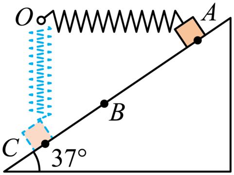

# Physics - 题目 2105

**ID**: 4b858686f1e94d0784e8dae399f00d42
**年级**: Grade 10
**难度**: Medium-Hard
**题型**: Multiple-choice

## 题目
如图所示，固定光滑斜面的倾角为37°，轻弹簧的一端固定在斜面上C点正上方的固定转轴O处，另一端与一质量为m的滑块（视为质点）相连，弹簧原长和O点到斜面的距离均为d。​​​​​​​‌将滑块从与O点等高的A点由静止释放，滑块经过O点在斜面上的垂足B点到达C点的过程中始终未离开斜面，滑块到达C点时弹簧的弹力小于滑块受到的重力，取sin37°=0.6，cos37°=0.8，重力加速度大小为g。下列说法正确的是（      ）

## 解答

1. A．滑块从A到B点，根据题意可知弹簧和重力都做正功，假如只有重力做功，根据动能定理
2. $mgd{\cos}37{^{\circ }}=\frac {1}{2}mv{^{2}}$
3. 解得
4. $v=\sqrt {\frac {8}{5}gd}$
5. 所以滑块经过B点的速度大于 $\sqrt {gd}$ ，故A错误；
6. BC．从A到C的过程中，重力沿斜面向下的分量不变，弹簧的弹力开始时沿斜面向下的分量逐渐减小，即合外力不断减小，而过B点后弹簧的弹力沿斜面向上的分量逐渐增大且小于重力沿斜面向下的分量，合外力逐渐减小，所以加速度是一直减小，但是加速度和速度方向始终一致，所以做加速度减小的加速运动，故B错误，C正确；
7. D．根据几何关系可得
8. $L{{}_{OA}}=\frac {5}{3}d$
9. 根据胡克定律
10. $F\mathrm{=}k\Delta x$
11. 根据题意在A点时，不脱离斜面，可得
12. $k\left ({\frac {5}{3}d-d}\right ){\sin}37{}^\circ <mg{\cos}37{}^\circ $
13. 解得
14. $k<\frac {2mg}{d}$
15. 故D错误。
16. 故选C。

## 知识点

**中文**:
  - 机械能守恒及其判断

**English**:
  - Judgment of Mechanical Energy Conservation

---
