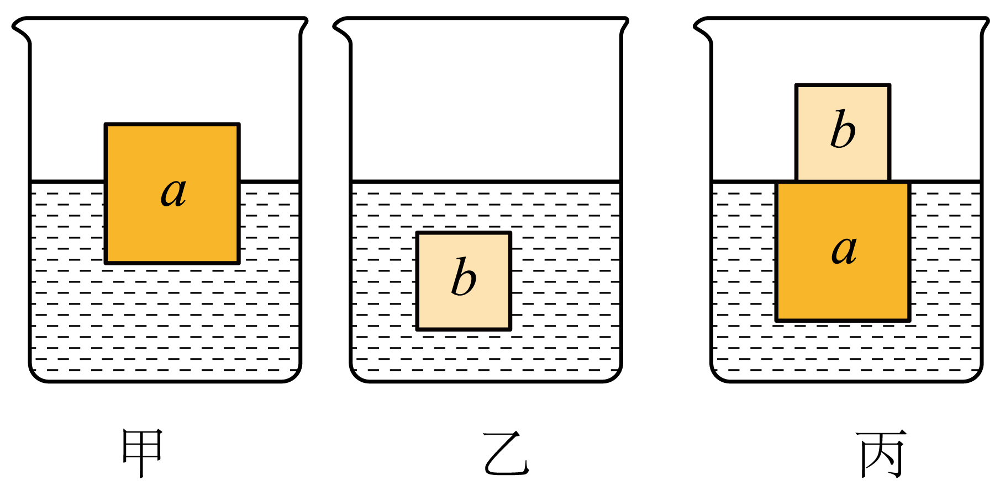

# Physics - 题目 935

**ID**: 5a36ea6ad2fd46069e15dfb7b3928e12
**年级**: Grade 10
**难度**: Medium-Hard
**题型**: Multiple-choice

## 题目
如图所示，放在水平桌面上的甲、乙、丙三个完全相同的烧杯中均装有适量的水，将质地均匀，且不吸水的a、b两实心体分别放入甲、乙烧杯中，当a、b静止时，a有五分之二的体积露出水面，b悬浮于水中，此时两烧杯液面刚好相平。​​​​​​​‌若将b置于a上一起放入丙烧杯中，静止时a的上表面刚好与液面相平，整个过程中水均未溢出，下列说法正确的是（      ）

## 解答

1. ABC．由漂浮、悬浮条件可知 $F{{}_{浮}}=G$ ，结合公式 $G=mg=ρgV$ 、 $F{{}_{浮}}=ρ{{}_{液}}gV{{}_{排}}$ ，可得：在甲中，a漂浮，有五分之二的体积露出水面，则有 $G{{}_{a}}=ρ{{}_{a}}gV{{}_{a}}$ ， $F{{}_{浮a}}=ρ{{}_{液}}gV{{}_{排a}}=\frac {3}{5}ρ{{}_{水}}gV{{}_{a}}$ ，即 $G{{}_{a}}=ρ{{}_{a}}gV{{}_{a}}=\frac {3}{5}ρ{{}_{水}}gV{{}_{a}}$ ，在乙中，b悬浮，则有 $G{{}_{b}}=F{{}_{浮}}{{}_{b}}=ρ{{}_{水}}gV{{}_{b}}$ ，在丙中，a、b漂浮，则有 $G{{}_{a}}+G{{}_{b}}=F{{}_{浮}}=ρ{{}_{水}}gV{{}_{a}}$ ，可得 $ρ{{}_{a}}=\frac {3}{5}ρ{{}_{水}}=0.6\times 10{^{{{3}}}}{\rm{k}}{\rm{g}}{\rm{/}}{\rm{m}}{^{{{3}}}}$ ， $2G{{}_{a}}=3G{{}_{b}}$ ，即 $G{{}_{a}}:G{{}_{b}}=3:2$ ， $V{{}_{a}}:V{{}_{b}}=5:2{\rm ，AB}$ 错误，C正确；
2. D．在甲、乙中，a、b漂浮，且两容器内液面相平，结合阿基米德原理可知 $G{{}_{排a}}=F{{}_{浮a}}=G{{}_{a}}$ ， $G{{}_{排b}}=F{{}_{浮b}}=G{{}_{b}}$ ，所以两容器内水和物体的总重力相等，两个相同的容器对水平桌面的压力为容器的重力与水和物体总重力的和，大小相等，D错误。选C。

## 知识点

**中文**:
  - 力学

**English**:
  - Mechanics

---
