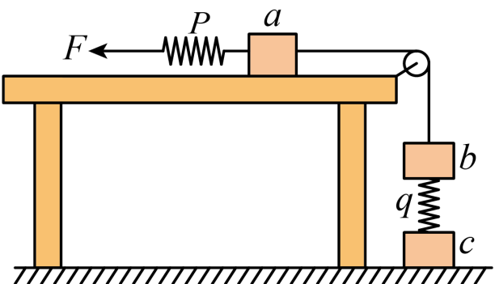

# Physics - 题目 1572

**ID**: 616dd9f8ee034b8b830f10ca71bce693
**年级**: Grade 10
**难度**: Medium-Hard
**题型**: Multiple-choice

## 题目
三个质量均为1 kg的相同木块 $a$ 、 $b$ 、 $c$ 和两个劲度系数均为 $500{\rm{N}}{\rm{/}}{\rm{m}}$ 的相同轻弹簧 $p$ 、 $q$ 用轻绳连接如图，其中 $a$ 放在光滑水平桌面上。​​​​​​​‌开始时 $p$ 弹簧处于原长，木块都处于静止。现用水平力 $F$ 缦慢地向左拉 $p$ 弹簧的左端，直到 $c$ 木块刚好离开水平地面为止， $g$ 取 $10{\rm{m}}{\rm{/}}{\rm{s}}{^{{{2}}}}$ 。该过程 $p$ 弹簧的左端向左移动的距离是（      ）

## 解答

1. 开始时 $q$ 弹簧处于压缩状态，由胡克定律可知，此时 $q$ 弹簧压缩了2 cm。 $c$ 木块刚好离开水平地面时，轻弹簧 $q$ 中的拉力为10 N，由胡克定律可知，轻弹簧 $q$ 伸长2 cm；轻弹簧 $p$ 中的拉力为20 N，由胡克定律可知，轻弹簧 $p$ 伸长4 cm；该过程 $p$ 弹簧的左端向左移动的距离是 $2{\rm{c}}{\rm{m}}+2{\rm{c}}{\rm{m}}+4{\rm{c}}{\rm{m}}=8{\rm{c}}{\rm{m}}$ ，选项C正确,ABD错误。选C。

## 知识点

**中文**:
  - 共点力与共点力平衡的条件
  - 弹力的大小与胡克定律

**English**:
  - Concurrent Forces and Equilibrium Conditions
  - Magnitude of Elastic Force and Hooke's Law

---
