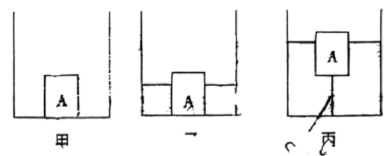

# Physics - 题目 1483

**ID**: 760ffd1a69a3454987321c97a279a4ed
**年级**: Grade 10
**难度**: Medium-Hard
**题型**: Multiple-choice

## 题目
如图甲所示，一个柱形容器放在水平桌面上，容器中立放着一个底面积为100cm^{2}，高为12cm，质量为900g的均匀实心长方体木块A，A的底部与容器底用一根细绳（细绳体积忽略不计）连在一起，已知细绳长度为L=8cm。​​​​​​​‌现慢慢向容器中加水，当加入1.8kg的水时，木块A对容器底部的压力刚好为0，如图乙所示，若继续缓慢向容器中加水，直到细绳被拉断，然后停止加水，如图丙所示，细绳拉断前、后木块静止时，水对容器底部压强的变化量为50Pa，（整个过程中无水溢出），则下列说法正确的是（      ）

## 解答

1. 木块的体积为 $V{{}_{{\rm{A}}}}=S{{}_{{\rm{A}}}}h{{}_{{\rm{A}}}}=100\times 12{\rm{c}}{\rm{m}}{^{{{3}}}}=1200{\rm{c}}{\rm{m}}{^{{{3}}}}$ ，木块的密度 $ρ{{}_{{\rm{A}}}}=\frac {m{{}_{{\rm{A}}}}}{V{{}_{{\rm{A}}}}}=\frac {900}{1200}{\rm{g}}{\rm{/}}{\rm{c}}{\rm{m}}{^{{{3}}}}=0.75{\rm{g}}{\rm{/}}{\rm{c}}{\rm{m}}{^{{{3}}}}=0.75\times 10{^{3}}{\rm{k}}{\rm{g}}{\rm{/}}{\rm{m}}{^{{{3}}}}$ ，故A错误；当加入1.8kg的水时，木块A对容器底部的压力刚好为0，此时木块恰好漂浮，因木块受到的浮力和自身的重力相等，由阿基米德原理可得 $F{{}_{浮}}=G{{}_{木}}=ρ{{}_{水}}gV{{}_{排}}=m{{}_{木}}g$ ，则木块排开水的体积 $V{{}_{排}}=\frac {m{{}_{木}}}{ρ{{}_{水}}}=\frac {900}{1.0}{\rm{c}}{\rm{m}}{^{{{3}}}}=900{\rm{c}}{\rm{m}}{^{{{3}}}}$ ，容器内水的深度为 $h{{}_{水}}=\frac {V{{}_{排}}}{S{{}_{{\rm{A}}}}}=\frac {900}{100}{\rm{c}}{\rm{m}}=9{\rm{c}}{\rm{m}}$ ，容器内加入水的体积 $V{{}_{水}}=\frac {m{{}_{水}}}{ρ{{}_{水}}}=\frac {1.8\times 10{^{3}}}{1.0}{\rm{c}}{\rm{m}}{^{{{3}}}}=1800{\rm{c}}{\rm{m}}{^{{{3}}}}$ ，又 $V{{}_{水}}=(S{{}_{容}}-S{{}_{{\rm{A}}}})h{{}_{水}}$ ，所以容器的底面积 $S{{}_{容}}=\frac {V{{}_{水}}}{h{{}_{水}}}+S{{}_{{\rm{A}}}}=\frac {1800}{9}+100{\rm{c}}{\rm{m}}{^{2}}=300{\rm{c}}{\rm{m}}{^{2}}$ ，故B错误；细绳拉断前、后木块静止时，由 $p=ρgh$ 可得，容器内水深度的变化量 $Δh=\frac {Δp}{ρ{{}_{水}}g}=\frac {50}{1.0\times 10{^{3}}\times 10}{\rm{m}}=5\times 10{^{-3}}{\rm{m}}=0.5{\rm{c}}{\rm{m}}$ ，木块排开水体积的减少量 $ΔV{{}_{排}}=S{{}_{容}}Δh=300\times 0.5{\rm{c}}{\rm{m}}{^{3}}=150{\rm{c}}{\rm{m}}{^{3}}$ ，则剪断细绳前木块排开水的体积 $V^{′}{{{}_{排}}}=V{{}_{排}}+ΔV{{}_{排}}=900+150{\rm{c}}{\rm{m}}{^{{{3}}}}=1050{\rm{c}}{\rm{m}}{^{{{3}}}}$ ，木块受到的浮力 $F^{′}{{{}_{浮}}}=ρ{{}_{水}}gV^{′}{{{}_{排}}}=1.0\times 10{^{3}}\times 10\times 1050\times 10{^{-6}}{\rm{N}}=10.5{\rm{N}}$ ，故C错误；细绳拉断前木块浸入水中的深度 $h^{′}{{{}_{水}}}=\frac {V^{′}{{{}_{排}}}}{S{{}_{{\rm{A}}}}}=\frac {1050}{100}{\rm{c}}{\rm{m}}=10.5{\rm{c}}{\rm{m}}$ ，容器内水的深度 $h^{′′}{{{}_{水}}}=h^{′}{{{}_{水}}}+h{{}_{绳}}=10.5+8{\rm{c}}{\rm{m}}=18.5{\rm{c}}{\rm{m}}$ ，容器内水的体积 $V{{}_{水总}}=S{{}_{容}}h^{′′}{{{}_{水}}}-V^{′}{{{}_{排}}}=300\times 18.5-1050{\rm{c}}{\rm{m}}{^{{{3}}}}=4500{\rm{c}}{\rm{m}}{^{{{3}}}}$ ，则最后容器中水的总质量 $m{{}_{水总}}=ρ{{}_{水}}V{{}_{水总}}=1.0\times 4500{\rm{g}}=4500g=4.5{\rm{k}}{\rm{g}}$ ，故D正确。

## 知识点

**中文**:
  - 力学

**English**:
  - Mechanics

---
