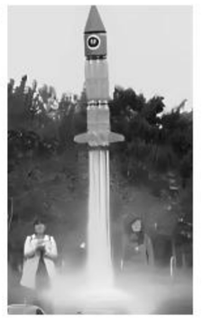

# Physics - 题目 1564

**ID**: 7fe26ecaf7594f28be5bc60a194ae577
**年级**: Grade 10
**难度**: Medium-Hard
**题型**: Multiple-choice

## 题目
某参赛团队设计的水火箭，发射后先在竖直方向做匀加速直线运动（有动力阶段），已知加速阶段加速度大小恒为 $a\text{=8 m/}{\text{s}}^{2}$ ，加速时间 ${t}_{1}\text{=3 s}$ ;燃料耗尽后，火箭仅在重力作用下做竖直上抛运动（忽略空气阻力， $g=\text{10 m/}{\text{s}}^{2}).​​​​​​​‌$ 下列说法正确的是（      ）

## 解答

1. 分析有动力阶段（匀加速直线运动）此阶段火箭初速度 ${v}_{0}{=0}$ ，加速度 $a\text{=8 m/}{\text{s}}^{2}$ ，时间 ${t}_{1}\text{=3 s}$ ，对应比赛中火箭“燃料推动上升”的过程：末速度（燃料耗尽瞬间）： $v={v}_{0}+{at}$ ，代入数据得 ${v}_{1}\text{=0+8×3 m/s=24 m/s}$ ，上升位移：根据匀加速位移公式 $x={v}_{0}t+\frac{1}{2}a{t}^{2}$ ，代入数据得 ${x}_{1}\text{=36.0 m}，\text{A}$ 正确：分析无动力阶段（竖直上抛运动）燃料耗尽后，火箭进入“仅受重力上升”的阶段，对应比赛中火箭“无动力冲高”的关键环节：上升时间：竖直上抛到最高点时速度 $v{=0}$ ，根据 $v={v}_{1}-g{t}_{2}$ ，代入数据得 ${0=24-10}{t}_{2}$ ，解得 ${t}_{2}\text{=2.4 s}，{\rm B}$ 正确；最大高度（总位移）：无动力阶段上升位移由 ${x}_{2}={v}_{1}{t}_{2}-\frac{1}{2}g{t}_{2}^{2}$ 得 ${x}_{2}\text{=28.8 m}$ ，总位移 ${x}_{总}\text{=36.0+28.8=64.8 m}$ .比赛中“比高”的核心是提升最大高度，根据 ${x}_{1}=\frac{1}{2}a{t}_{1}^{2}$ ，在加速时间不变时，增大加速度 $a$ 可增大有动力阶段位移，进而提升总高度，D正确：分析选项 $\text{C}$ （位移为 $\text{52.0 m}$ 时的时间解）该位移对应比赛中火箭上升、下落过程中两次经过同一高度的场景：阶段判断：有动力阶段最大位移为 $\text{36.0 m}$ （小于 $\text{52.0 m}）$ ，故 $\text{52.0 m}$ 仅出现在无动力阶段 $(t\text{>3 s})$ .列方程求解：设无动力阶段时间为 ${t}^{\prime }=t\text{-3 s}$ ，总位移 ${36.0+24}{t}^{\prime }{-5}{t}^{\prime 2}{=52.0}$ ，整理得 $5{t}^{\prime 2}{-24}{t}^{\prime }{+16=0}$ .解得 ${t}_{1}^{\prime }\text{=0.8 s}$ （对应总时间 ${t}_{3}\text{=3.8 s}{），}{t}_{2}^{\prime }\text{=4.0 s}$ （对应总时间 ${t}_{1}\text{=7.0 s}）$ ，分别对应上升、下落经过 $\text{52.0 m}$ 处， $C$ 错误

## 知识点

**中文**:
  - 匀变速直线运动的位移—时间公式及其应用
  - 匀变速直线运动的速度—时间公式及其应用

**English**:
  - Displacement-Time Formula and Applications
  - Velocity-Time Formula and Applications

---
