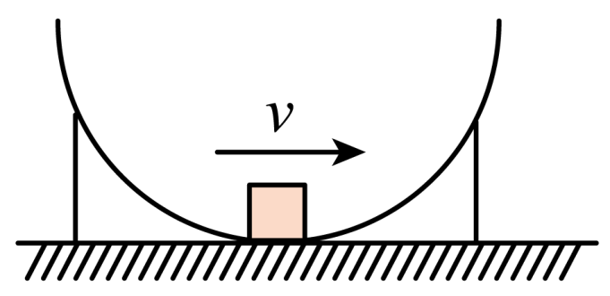

# Physics - 题目 144

**ID**: 8b66a7c50fe148b0af5f575f845e8095
**年级**: Grade 10
**难度**: Medium-Hard
**题型**: Multiple-choice

## 题目
如图所示，质量为m的物块，沿着半径为R的半球形金属壳内壁滑下，半球形金属壳竖直固定放置，开口向上，滑到最低点时速度大小为v，若物体与球壳之间的摩擦因数为μ，则物体在最低点时，下列说法正确的是（      ）​​​​​​​‌

## 解答

1. 物体滑到半球形金属球壳最低点时，速度大小为v，半径为R，向心力大小为 $F{{}_{{\rm{n}}}}=m\frac {v{^{2}}}{R}{\rm ，A}$ 错误；根据牛顿第二定律得 $N-mg=m\frac {v{^{2}}}{R}$ ，得到金属球壳对小球的支持力 $N=mg+m\frac {v{^{2}}}{R}$ ，由牛顿第三定律可知，小球对金属球壳的压力大小 $N^{′}=N=mg+m\frac {v{^{2}}}{R}$ ，物体在最低点时，受到的摩擦力为 $f=μN=μ(mg+m\frac {v{^{2}}}{R}){\rm ，B}$ 正确，C错误；物块竖直方向的合力向上，还受到水平方向的摩擦力，所以在最低点总的合力不是竖直向上，而是斜向上，D错误。

## 知识点

**中文**:
  - 竖直面内圆周运动问题

**English**:
  - Circular Motion in Vertical Plane

---
