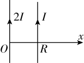

# Physics - 题目 919

**ID**: 8e4c7b17fdea407986b475f0d0ed6efb
**年级**: Grade 10
**难度**: Medium-Hard
**题型**: Multiple-choice

## 题目
通电导线周围某点的磁感应强度B与导线中电流I成正比、与该点到导线的距离r成反比.​​​​​​​‌如图所示，两根相距为R的平行长直导线，通以大小分别为2I、I且方向相同的电流.规定磁场方向垂直纸面向里为正，在Ox坐标轴上磁感应强度B随x变化的图线可能是    	（      ）

## 解答

1. 根据右手螺旋定则可知左边通电导线在两根导线之间产生的磁场方向垂直纸面向里，右边通电导线在两根导线之间产生的磁场方向垂直纸面向外，离导线越远磁场越弱，因左边导线中电流是右边的2倍，在两根导线之间距右侧导线 $\frac{1}{3}{\rm \mathit{R}}$ 处磁感应强度为零.由于规定垂直纸面向里为B的正方向，那么在0到 $\frac{2}{3}{\rm \mathit{R}}$ 区域磁感应强度为正，而在 $\frac{2}{3}{\rm \mathit{R}}$ 到R区域磁感应强度为负，从R到无穷远处，磁感应强度为正，所以B正确.

## 知识点

**中文**:
  - 电流的磁效应
  - 磁场的叠加

**English**:
  - Magnetic Effect of Current
  - Superposition of Magnetic Fields

---
