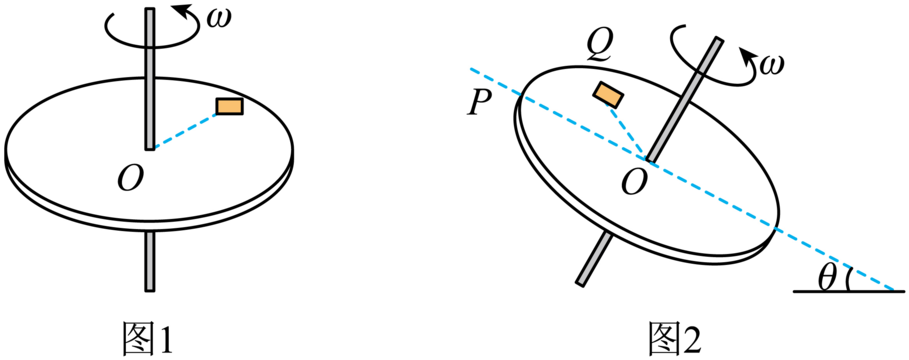

# Physics - 题目 2552

**ID**: 9ebabf937880416e82d2d50deae1525f
**年级**: Grade 10
**难度**: Medium-Hard
**题型**: Multiple-choice

## 题目
如图所示，一匀质圆盘绕垂直于盘面的对称轴以恒定的角速度转动，盘面上离转轴距离1米处有一小物块随圆盘一起转动，小物块的质量为1kg。​​​​​​​‌圆盘水平放置时，如图1所示，为使小物块不被圆盘甩出，圆盘的最大角速度为 $\sqrt {10}{\rm rad}$ /s。将盘面与水平面的夹角调整为37°，为使小物块不被圆盘甩出，圆盘的最大角速度为ω，如图2所示。下列关于调整后的判断，正确的有（设最大静摩擦力等于滑动摩擦力，g取10m/s^{2}）（      ）

## 解答

1. 当如图1时，由图可知物块与盘的最大静摩擦力为 $f={\rm μm}g=mω{^{2}}r=10{\rm{N}}$
2. 如图2，当物体转到圆盘的最低点，所受的静摩擦力沿斜面向上达到最大时，角速度最大，由牛顿第二定律得 ${\rm μm}g{\cos}37{}\degree -mg\sin 37{}\degree =mrω{^{2}}$
3. 得 $ω=\sqrt {2}{\rm rad}/{\rm{s}}$
4. 故A正确； 由上分析可知，圆盘绕垂直于盘面的对称轴以恒定的角速度转动，向心力为 $F{{}_{n}}=mωr{^{2}}=2{\rm{N}}$
5. 根据物块的受力可知，物块做与匀速圆周运动的向心力由重力沿盘面的分力和摩擦力提供，其中重力沿盘面的分力为 $F{{}_{{\rm{G}}}}=mg\sin θ=6{\rm{N}}$
6. 由二力合成的范围可知 $f=\sqrt {F{{}_{{\rm{n}}}^{2}}+F{{}_{{\rm{G}}}^{2}}-2F{{}_{{\rm{n}}}}F{{}_{{\rm{G}}}}{\cos}\angle POQ}$
7. 解得 $f=\sqrt {40-24{\cos}\angle POQ}$
8. 故从最高点到最低点， $\angle POQ$ 从 $0\degree $ 增加到 $180{}\degree $ ，所以小物块受到的摩擦力一直增大，故B错误； 由B项分析可知，当由 $\angle POQ=60{}\degree $ 时 $f=2\sqrt {7}{\rm{N}}$
9. 当 $\angle POQ=120{}\degree $ 时 $f=2\sqrt {13}{\rm{N}}$
10. 故C正确、D错误。

## 知识点

**中文**:
  - 倾斜面内的圆周运动问题

**English**:
  - Circular Motion on Inclined Planes

---
