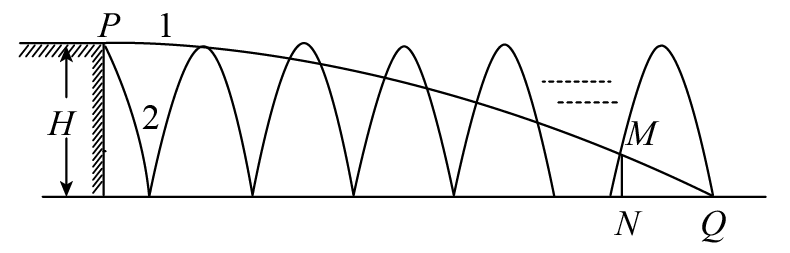

# Physics - 题目 2439

**ID**: aab2502acc1a4dc5a92db80ec5a118a6
**年级**: Grade 10
**难度**: Medium-Hard
**题型**: Multiple-choice

## 题目
如图所示，从高H处的P点先后水平抛出两个小球，球1刚好直接越过竖直挡板MN落在水平地面上的Q点，球2与地面碰撞N（N≥1）次后，刚好越过高为h的挡板MN（h可调节）也落在Q点。​​​​​​​‌假设球2每次与地面的碰撞都是弹性碰撞，两球的空气阻力均可忽略，则（      ）

## 解答

1. AB．如图所示
2. 
3. 设球1的初速度为v_{1}，球2的初速度为v_{2}，OE=d，由几何关系和对称性可知
4. OQ=(2n-1)d
5. 球1从P点飞到Q点的运动时间为
6. $t{{}_{1}}=\sqrt {\frac {2H}{g}}$
7. 球1从P点飞到Q点在水平方向有
8. $v{{}_{1}}\sqrt {\frac {2H}{g}}=(2n-1)d$
9. 由对称性可知，球2从P点飞到Q点时间t_{2}是球1从P点飞到Q点的运动时间t_{1}的(2n-1)倍，则两球在水平方向有
10. v_{1}t_{1}=v_{2}t_{2}
11. 且
12. t_{2}=(2n-1)t_{1}
13. 故
14. v_{1}=(2n-1)v_{2}
15. 由分运动的等时性可知：球1从P点飞到挡板M点的时间与球2从P点飞到C点的时间相等；由对称性可知球2从M点飞到D点与由P飞到C的时间相等，OD两点间的水平距离为(2n-2)d。球1从P点飞到M点与球2由M点飞到D点水平方向有
16. $v{{}_{1}}\sqrt {\frac {2(H-h)}{g}}+v{{}_{2}}\sqrt {\frac {2(H-h)}{g}}=2(n-1)d$
17. 解得
18. $\frac {h}{H}=\frac {2n-1}{n{^{2}}}$
19. 当n=6时 $\frac {h}{H}=\frac {11}{36}$ 但不可能等于 $\frac {1}{2}$ ，A错误，B正确；
20. CD．根据v_{1}=(2n-1)v_{2}可知，球1与球2速度之比不可能为2:1，也不可能是16:1，CD错误。
21. 故选B。

## 知识点

**中文**:
  - 求解平抛运动、类平抛运动问题

**English**:
  - Solving Horizontal and Quasi-Horizontal Projectile Problems

---
