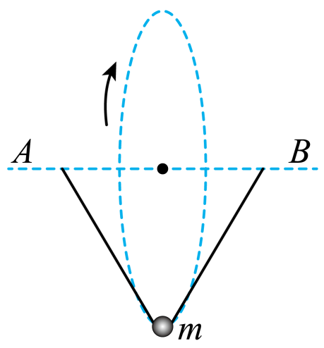

# Physics - 题目 916

**ID**: abddbcf1225e4d3bacd79e2b5caadf59
**年级**: Grade 10
**难度**: Medium-Hard
**题型**: Multiple-choice

## 题目
如图所示，长度均为l=1m的两根轻绳，一端共同系住质量为 $m=0.​​​​​​​‌5{\rm{k}}{\rm{g}}$ 的小球，另一端分别固定在等高的A、B两点，A、B两点间的距离也为1m，重力加速度g取10m/s^{2}，现使小球在竖直平面内以AB为轴做圆周运动，若小球在最高点速率为v时，每根绳的拉力为零，则小球在最高点速率为2v时，每根绳的拉力大小为（      ）

## 解答

1. 小球在最高点时速率为v时，每根绳的拉力为零，得 $mg=m\frac {v{^{2}}}{r}$ ，小球在最高点速率为2v时，设每根绳的拉力大小为F，则 $mg{{+}}{{2}}F{{}_{{\rm{T}}}}{\cos}30{^{\circ }}=m\frac {4v{^{2}}}{r}$ ，解得 $F{{}_{{\rm{T}}}}=\sqrt {3}mg=5\sqrt {3}{\rm{N}}$ ，选A。

## 知识点

**中文**:
  - 向心力的计算及应用
  - 绳、杆类圆周运动问题
  - 竖直面内圆周运动问题

**English**:
  - Calculation and Application of Centripetal Force
  - String and Rod Circular Motion Problems
  - Circular Motion in Vertical Plane

---
