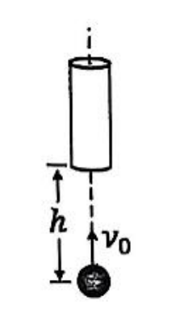

# Physics - 题目 2980

**ID**: ac9d64a0c0bb4ca5b7fe56f8a3fc6187
**年级**: Grade 10
**难度**: Medium-Hard
**题型**: 选择题：本题共4小题，每小题5分，共20分。在每小题给出的四个选项中，有多项符合题目要求，全部选对的得5分，选对但不全的得3分，有选错的得0分。

## 题目
如图所示，小球位于竖直空心管的最下端 $\text{h}$ 处，管的内径大于小球直径。​​​​​​​‌ 某一时刻开始，竖直空心管由静止释放，下落 $\text{Δ}t$ 后（此时管的最下端未接触到小球）将小球以 ${v}_{0}$ 的初速度竖直上抛 $({v}_{0}.$ 足够大），小球穿过管的时间为 $t$ ，下列说法正确的是（      ）${\rm A}．$ 仅减小 $\text{Δ}t，t$ 变大${\rm B}．$ 仅减小 $\text{Δ}t，t$ 变小${\rm C}．$ 仅增大 $\text{h}，t$ 变大${\rm D}．$ 仅增大 ${v}_{0}，t$ 变小

## 解答

1. 在 $\text{Δ}t$ 时间内竖直管的位移和速度为 ${\text{h}}^{\prime }=\frac{1}{2}g\text{Δ}{t}^{2}，{v}^{\prime }=g\text{Δ}t$ 。设 $\text{Δ}t$ 后又经过时间 ${t}_{1}$ 后，竖直管的最下端与小球相遇，此时有 ${v}^{\prime }{t}_{1}+\frac{1}{2}g{t}_{1}^{2}+{v}_{0}{t}_{1}-\frac{1}{2}g{t}_{1}^{2}\text{=h-}{\text{h}}^{\prime }$ 。解得： ${t}_{1}=\frac{\text{h}\frac{1}{2}g\text{Δ}{t}^{2}}{g\text{Δ}t+{v}_{0}}$
2. 设 $\text{Δ}t$ 后又经过时间 ${t}_{2}$ 后，竖直管的最上端与小球相遇，此时有 ${v}^{\prime }{t}_{2}+\frac{1}{2}g{t}_{2}^{2}+{v}_{0}{t}_{2}-\frac{1}{2}g{t}_{2}^{2}\text{=h-}{\text{h}}^{\prime }+L$
3. 其中 $\text{L}$ 为竖直管的长度，可解得： ${t}_{2}=\frac{\text{h+}L\frac{1}{2}g\text{Δ}{t}^{2}}{g\text{Δ}t+{v}_{0}}$
4. 小球穿过竖直管所花时间 $t={t}_{2}-{t}_{1}$ ， 即 $t=\frac{L}{g\text{Δ}t+{v}_{0}}$
5. 因此，仅仅减小 $\text{Δ}t$ 的情况下， $t$ 变大；仅增大 $\text{h}$ 的情况下， $t$ 不变；仅增大 ${v}_{0}$ 的情况下， $t$ 变小。 所以，A、D正确。故选 $\text{AD}$ 。（用相对运动法会更加简洁）

## 知识点

**中文**:
  - 自由落体运动和竖直上抛运动的相遇问题

**English**:
  - Encounter Problems: Free Fall and Vertical Throw

---
