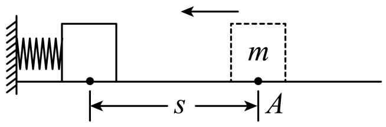

# Physics - 题目 2569

**ID**: af95226946b24a8ebbbffe2b00991d13
**年级**: Grade 10
**难度**: Medium-Hard
**题型**: Multiple-choice

## 题目
如图所示，轻质弹簧的左端固定，并处于自然状态。​​​​​​​‌小物块的质量为m，从A点向左沿水平地面运动，压缩弹簧后被弹回，运动到A点恰好静止。物块向左运动的最大距离为s，与地面间的动摩擦因数为μ，重力加速度为g，弹簧未超出弹性限度。在上述过程中（      ）

## 解答

1. A．物体从静止向右运动时，弹力先大于摩擦力，当弹簧的弹力与滑动摩擦力大小相等时，即 $F={\rm μm}g$ 时，速度最大，物体继续向右运动，弹簧继续伸长直到自然状态，所以弹簧的最大弹力大于 ${\rm μm}g{\rm ，A}$ 错误；
2. B．整个过程中，物块所受的摩擦力大小恒定，摩擦力一直做负功，则物块克服摩擦力做的功为 $2{\rm μm}gs{\rm ，B}$ 错误；
3. C．物体向右运动的过程，根据能量守恒定律得，弹簧的最大弹性势能 $E{{}_{p}}={\rm μm}gs{\rm ，C}$ 错误；
4. D．设物块在A点的初速度为 $v{{}_{0}}$ ，对整个过程，利用动能定理得 $-2{\rm μm}gs=0-\frac {1}{2}mv{{}_{0}}{^{2}}$ ，可得 $v{{}_{0}}=2\sqrt {μgs}{\rm ，D}$ 正确。选D。

## 知识点

**中文**:
  - 动能定理在往返运动中的应用
  - 弹性势能的变化与弹力做功的关系

**English**:
  - Applications in Reciprocating Motion
  - Change in Elastic PE and Work Done by Elastic Force

---
