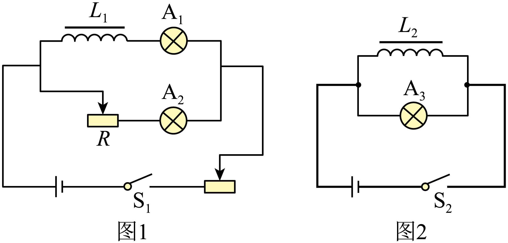

# Physics - 题目 2812

**ID**: b29329595d9b48969b785252f5341294
**年级**: Grade 10
**难度**: Medium-Hard
**题型**: Multiple-choice

## 题目
如图1、2为演示自感现象的电路图，灯泡A_{1}和A_{2}规格相同，L_{1}和L_{2}为线圈。​​​​​​​‌实验时，闭合开关S_{1}，灯A_{1}逐渐变亮，最终A_{1}与A_{2}的亮度相同；断开开关S_{2}瞬间，灯A_{3}突然闪亮，随后逐渐变暗。下列说法正确的是（      ）

## 解答

1. 图1中，最终A_{1}与A_{2}的亮度相同，两个支路电流相同，又由于两个灯泡电阻相同，所以变阻器R与L_{1}的电阻值相同，A正确；图1中，闭合S_{1}瞬间，电感线圈由于自感现象，L_{1}对电流有阻碍作用，此时自感线圈相当于一个新电源，两灯泡会逐渐熄灭，而稳定时两并联支路的电流相等，则灯A_{2}将不会闪亮，B错误；图2中，断开S_{2}的瞬间，A_{3}灯突然闪亮，是因为电路稳定时，L_{2}的电流大于A_{3}的电流，可知L_{2}的电阻小于A_{3}的电阻，CD错误；

## 知识点

**中文**:
  - 自感现象的理解与分析

**English**:
  - Understanding and Analysis of Self-Induction

---
