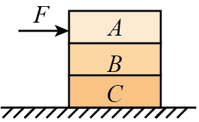

# Physics - 题目 479

**ID**: b71534990d1e414eac136d584200b12a
**年级**: Grade 10
**难度**: Medium-Hard
**题型**: Multiple-choice

## 题目
三个表面粗糙程度不同的木板A、B、C质量均为m，它们叠放在一起置于光滑的水平面上，木板A、B之间的动摩擦因数为 $μ$ ，木板B、C之间的动摩擦因数为 $\frac {μ}{5}$ ，设最大静摩擦力等于滑动摩擦力，重力加速度为g。​​​​​​​‌现用水平向右的力F推木板A，下列说法正确的是（      ）

## 解答

1. BD．A对B的最大静摩擦力
2. $f{{}_{{\rm{A}}{\rm{B}}{\rm{m}}}}={\rm μm}g$
3. B对C的最大静摩擦力
4. $f{{}_{{\rm{B}}{\rm{C}}{\rm{m}}}}=\frac {2}{5}{\rm μm}g$
5. 假设B与C恰好发生相对滑动时，A与B不发生相对滑动，以C为研究对象，根据牛顿第二定律可有
6. $f{{}_{{\rm{B}}{\rm{C}}{\rm{m}}}}=ma$
7. 解得
8. $a=\frac {2}{5}μg$
9. 此时对B、C组成的整体受力分析，根据牛顿第二定律有
10. $f{{}_{{\rm{A}}{\rm{B}}}}=2ma=\frac {4}{5}{\rm μm}g<{\rm μm}g$
11. 假设成立，即当B与C恰好发生相对滑动时，A与B不会发生相对滑动；当以加速度为 $\frac {2}{5}μg$ 加速运动时，B与C恰好发生滑动，对A，B组成的整体，根据牛顿第二定律可有
12. $F-\frac {2}{5}{\rm μm}g=2ma$
13. 解得
14. $F=1.2{\rm μm}g$
15. 故当 $F\leqslant 1.2{\rm μm}g$ 时，A、B、C相对静止，则BD错误；
16. AC．当 $F>1.2{\rm μm}g$ 时，B与C一定会发生相对滑动，A与B不一定会发生滑动，设 $F=F{{}_{0}}$ 时A与B恰好发生相对滑动，则有
17. $\frac {F{{}_{0}}-{\rm μm}g}{m}=\frac {{\rm μm}g-\frac {2}{5}{\rm μm}g}{m}$
18. 解得
19. $F{{}_{0}}=1.6{\rm μm}g$
20. 故当 $1.2{\rm μm}g<F\leqslant 1.6{\rm μm}g$ ，A与B会相对静止，B与C相对滑动，A正确，C错误。
21. 故选Ａ。

## 知识点

**中文**:
  - 牛顿第二定律的简单计算

**English**:
  - Simple Calculations of Newton's 2nd Law

---
