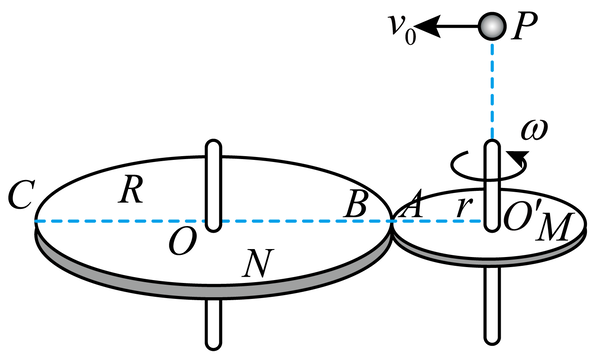

# Physics - 题目 1684

**ID**: c236844aa86d42d38ed98fa3728dd4a3
**年级**: Grade 10
**难度**: Medium-Hard
**题型**: Multiple-choice

## 题目
如图所示，靠在一起的 $M$ 、 $N$ 两转盘靠摩擦传动，两盘均绕过圆心的竖直轴转动， $M$ 盘的半径为 $r$ ， $N$ 盘的半径 $R=2r$ 。​​​​​​​‌ $\mathrm{A}$ 为 $M$ 盘边缘上的一点， $B$ 、 $C$ 为 $N$ 盘直径的两个端点．当 $O^{′}$ 、 $\mathrm{A}$ 、 $B$ 、 $C$ 共线时，从 $O^{′}$ 的正上方P点以初速度 $v{{}_{0}}$ 沿 $O^{′}O$ 方向水平抛出一小球．小球落至圆盘 $C$ 点，重力加速度为 $g$ 。则下列说法正确的是（      ）

## 解答

1. 于 $M$ 、 $N$ 两转盘靠摩擦传动， $\frac {ω{{}_{M}}}{ω{{}_{N}}}=\frac {R}{r}=\frac {2}{1}$ ，小球抛出做平抛运动，若小球能落到 $C$ 点，则根据平抛运动的规律知 $h=\frac {1}{2}gt{^{2}}$ ， $x=v{{}_{0}}t$ ，若 $N$ 盘转过一周的整数倍，有 $t=\frac {2nπ}{ω{{}_{N}}}\left ({n\in {\mathbf{N}^{*}}}\right )$ ， $x=r+2R=5r$ ，时小球可落到 $C$ 点；若 $N$ 盘转过半周的奇数倍，有 $t=\frac {\left ({2n-1}\right )π}{ω{{}_{N}}}\left ({n\in {\mathbf{N}^{*}}}\right )$ ， $x=r$ ，即 $\frac {4πn}{ω{{}_{M}}}=\frac {5r}{v{{}_{0}}}\left ({n\in {\mathbf{N}^{*}}}\right )$ 或者 $\frac {\left ({4n-2}\right )π}{ω{{}_{M}}}=\frac {r}{v{{}_{0}}}\left ({n\in {\mathbf{N}^{*}}}\right )$ ，若 $M$ 盘转动角速度 $ω=\frac {2πv{{}_{0}}}{r}$ ，则 $x=r\left ({n=1}\right )$ ， $h=\frac {1}{2}gt{^{2}}=\frac {gr{^{2}}}{2v{{}_{0}^{2}}}{\rm ，A}$ 正确；若小球抛出时到 $O^{′}$ 的高度为 $\frac {gr{^{2}}}{2v{{}_{0}^{2}}}$ ，由A知 $x=r$ ，即满足 $\frac {\left ({4n-2}\right )π}{ω{{}_{M}}}=\frac {r}{v{{}_{0}}}\left ({n\in {\mathbf{N}^{*}}}\right )$ ，即可，B错误；由A知，只要 $M$ 盘转动角速度满足 $\frac {4πn}{ω{{}_{M}}}=\frac {5r}{v{{}_{0}}}\left ({n\in {\mathbf{N}^{*}}}\right )$ 或者 $\frac {\left ({4n-2}\right )π}{ω{{}_{M}}}=\frac {r}{v{{}_{0}}}\left ({n\in {\mathbf{N}^{*}}}\right )$ ，均可落到 $C$ 点，C错误；
2. 由以上分析可知，要想到达 $C$ 点，除了考虑高度，还要考虑初速度，D错误。

## 知识点

**中文**:
  - 共轴转动、皮带传动及齿轮传动问题
  - 平抛运动与斜面、圆轨道相结合问题
  - 圆周运动的周期性多解问题

**English**:
  - Coaxial Rotation, Belt Drive, and Gear Drive Problems
  - Horizontal Projectile on Inclined Planes and Circular Tracks
  - Multi-solution Problems due to Periodicity

---
