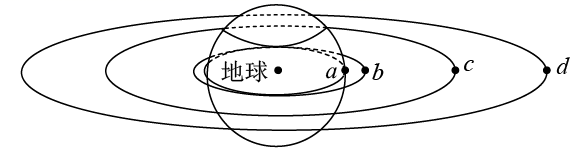

# Physics - 题目 1009

**ID**: cdef793feba14f919bc9b0a0dc370a8d
**年级**: Grade 10
**难度**: Medium-Hard
**题型**: Multiple-choice

## 题目
a、b、c、d四颗地球卫星，a还未发射，在地球赤道上随地球表面一起转动，向心加速度为 $a{{}_{1}}$ ，b处于地面附近近地轨道上，正常运行速度为 $v{{}_{1}}$ ，c是地球同步卫星，离地心距离为r，运行速度为 $v{{}_{2}}$ ，向心加速度为 $a{{}_{2}}$ ，d是高空探测卫星，各卫星排列位置如图所示，地球的半径为R，则有（      ）​​​​​​​‌

## 解答

1. A．地球同步卫星c的周期必须与地球自转周期相同，角速度相同，则知a与c的角速度相同，根据
2. $a=ω{^{2}}r$
3. 知，c的向心加速度大。 由
4. $G\frac {Mm}{r{^{2}}}=mg$
5. 得
6. $g=\frac {GM}{r{^{2}}}$
7. 卫星的轨道半径越大，向心加速度越小，则同步卫星的向心加速度小于b的向心加速度，而b的向心加速度约为g，故知a的向心加速度小于重力加速度g。故A错误；
8. B．由开普勒第三定律
9. $\frac {R{^{3}}}{T{^{2}}}=k$
10. 知，卫星的轨道半径越大，周期越大，所以d的运动周期大于c的周期24h，故B错误；
11. C．a、c的角速度相同，由
12. $a=ω{^{2}}r$
13. 得
14. $\frac {a{{}_{1}}}{a{{}_{2}}}=\frac {R}{r}$
15. 故C错误。
16. D．由
17. $G\frac {Mm}{r{^{2}}}=m\frac {v{^{2}}}{r}$
18. 得
19. $v=\sqrt {\frac {GM}{r}}$
20. 则得
21. $\frac {v{{}_{1}}}{v{{}_{2}}}=\sqrt {\frac {r}{R}}$
22. 故D正确。
23. 故选D。

## 知识点

**中文**:
  - 近地卫星、同步卫星和赤道上随地球自转物体的分析比较

**English**:
  - Comparison: Near-Earth, Geostationary Satellites and Objects on Equator

---
