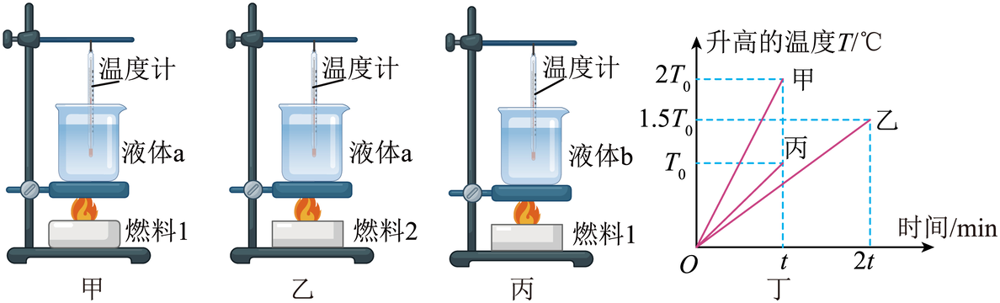

# Physics - 题目 247

**ID**: cff377b772e7473e87d2083f73b707c0
**年级**: Grade 10
**难度**: Medium-Hard
**题型**: Multiple-choice

## 题目
如图所示，用完全相同的装置利用燃料加热液体。​​​​​​​‌已知燃料的质量、烧杯内的液体质量、加热方式等均相同，不计热量损失，将燃料点燃直至燃尽，甲、乙、丙三套装置的烧杯中液体升高的温度随时间变化的图像如图丁所示，则下列说法错误的是（      ）

## 解答

1. 为了比较热值大小要用不同的燃料，加热同一种液体，让液体的质量相同，通过温度计的示数高低得出吸热多少，进而判断热值大小，需要选择甲、乙两图进行实验，A正确；为了比较两种液体的吸热能力的大小，需要燃烧同种燃料，加热不同的液体，且液体的质量相同，在加热时间相同时，根据转换法可知，通过温度计的示数高低进而判断两种比热容的大小关系，需要选择甲、丙两图进行实验，B正确；比热容是物质的一种特性，各种物质都有自己的比热容，某种物质的比热容与物质的质量和体积大小无关；燃料的热值是燃料的一种特性，与燃料的质量和体积V无关，C正确；根据图丁可知，燃料燃烧完时，燃料1燃烧了tmin，燃料2燃烧了2tmin，且甲图中液体温度变化量为2T_{0}，乙图中液体温度变化量为1.5T_{0}，不计热量损失，且两杯液体的质量、比热容均相同，根据公式Q=cmΔt可知，二者放出的热量之比为 $\frac {Q{{}_{1}}}{Q{{}_{2}}}=\frac {cmΔt{{}_{1}}}{cmΔt{{}_{2}}}=\frac {Δt{{}_{1}}}{Δt{{}_{2}}}=\frac {2T{{}_{0}}}{1.5T{{}_{0}}}=\frac {4}{3}$ ，燃料的质量相同，根据公式Q=qm可知，燃料1与燃料2的热值之比为q_{1}：q_{2}=Q_{1}：Q_{2}=4：3，D错误。此题选择错误选项。

## 知识点

**中文**:
  - 热学

**English**:
  - Thermal Physics

---
