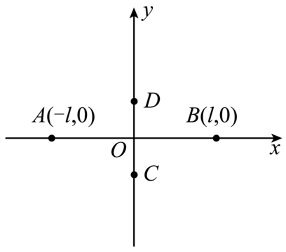

# Physics - 题目 1290

**ID**: d618f9663e7248118a27ba1ab373f91c
**年级**: Grade 10
**难度**: Medium-Hard
**题型**: Multiple-choice

## 题目
直角坐标系xOy中，A、B两点位于x轴上，坐标如图所示，C、D位于y轴上，C、D两点各固定一等量正点电荷，另一电荷量为Q的负点电荷置于O点时，B点处的电场强度恰好为零，若将该负点电荷移到A点，则B点处场强的大小和方向分别为（静电力常量为k）（      ）​​​​​​​‌

## 解答

1. B点处的电场强度恰好为零，说明负电荷在B点产生的场强与正电荷在B点产生的场强大小相等方向相反，根据点电荷的场强公式可得，负电荷在B点的场强为 $k\frac {Q}{l{^{2}}}$ ，两正电荷在B点的合场强也为 $k\frac {Q}{l{^{2}}}$ ，当负点电荷移到A点时，负电荷与B点的距离为2l，负电荷在B点产生的场强为 $k\frac {Q}{4l{^{2}}}$ ，方向沿x轴负方向，由于CD对称，所以两正电荷在B点产生的合场强的大小为 $k\frac {Q}{l{^{2}}}$ ，方向沿x轴正方向，所以B点处场合强的大小为 $k\frac {Q}{l{^{2}}}-k\frac {Q}{4l{^{2}}}=\frac {3kQ}{4l{^{2}}}$ ，方向沿x轴正方向。

## 知识点

**中文**:
  - 点电荷的场强

**English**:
  - Field Strength of Point Charge

---
