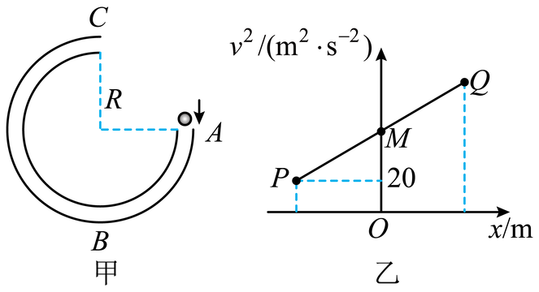

# Physics - 题目 2501

**ID**: e6e2e852783141e6a2db861d3f657fc5
**年级**: Grade 10
**难度**: Medium-Hard
**题型**: Multiple-choice

## 题目
如图甲，在竖直平面内固定一光滑的四分之三圆形轨道ABC，轨道半径 $R=4{\rm{m}}$ ，质量为 $m=1{\rm{k}}{\rm{g}}$ 的小球以一定的初速度从A点竖直向下进入轨道，经过最低点B，到达最高点C，图乙是小球在轨道上从A点运动到C点的过程中，其速度的平方与竖直方向的位移的完整关系图像。​​​​​​​‌阻力不计，重力加速度g取 $10{\rm{m}}/{\rm{s}}{^{2}}$ ，下列说法正确的是（      ）

## 解答

1. 由图可知，小球运动到C点时速度最小，对应图中P点，根据 $mg+F=\frac {mv{{}_{C}^{2}}}{R}$ ，解得 $F=-5{\rm{N}}$ ，负号表示小球受到轨道向上的力，根据牛顿第三定律，小球运动到C点时对轨道的作用力方向竖直向下，A错误；从A点到达最高点C，根据动能定理 $-mgR=\frac {1}{2}mv{{}_{C}^{2}}-\frac {1}{2}mv{{}_{A}^{2}}$ ，解得 $v{{}_{A}}=10{\rm{m}}/{\rm{s}}{\rm ，B}$ 正确；图乙中的M点不一定对应小球运动过程中的A点，也可以表示轨道左侧与A的等高点，C错误；从A点到B点，根据动能定理 $mgR=\frac {1}{2}mv{{}_{B}^{2}}-\frac {1}{2}mv{{}_{A}^{2}}$ ，在B点根据牛顿第二定律 $F{{}_{{\rm{N}}}}-mg=\frac {mv{{}_{B}^{2}}}{R}$ ，根据牛顿第三定律 $F{{}_{压}}=F{{}_{{\rm{N}}}}$ ，解得 $F{{}_{压}}=55{\rm{N}}{\rm ，D}$ 错误。

## 知识点

**中文**:
  - 应用动能定理求解与图像相关的动能问题

**English**:
  - Graph-related Kinetic Energy Problems

---
