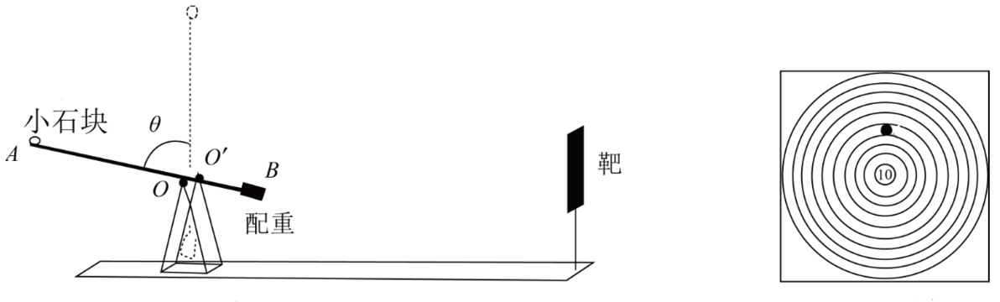

# Physics - 题目 2380

**ID**: f10ee069aabc484aad703d484dc3a115
**年级**: Grade 10
**难度**: Medium-Hard
**题型**: Multiple-choice

## 题目
如图所示是某科技小组制作的投石机的模型。​​​​​​​‌轻杆 $AB$ 可绕固定转轴 $OO^{′}$ 在竖直面内自由转动，A端凹槽内放置一小石块，B端固定配重。某次试验中，调整杆与竖直方向的夹角为 $θ$ 后，由静止释放，杆在配重重力作用下转到竖直方向时，石块被水平抛出，打到正前方靶心上方6环处，不计所有阻力。若要正中靶心，可以采取的措施有（      ）

## 解答

1. A．设石块和配重的质量分别为m_{1}、m_{2}，石块和配重到转轴的距离分别为l_{1}、l_{2}，石块被抛出时的速度大小为v_{1}，则此时配重的速度大小为 $v{{}_{2}}=\frac {v{{}_{1}}l{{}_{2}}}{l{{}_{1}}}$  ①，根据机械能守恒定律有 $m{{}_{2}}gl{{}_{2}}(1-{\cos}θ)-m{{}_{1}}gl{{}_{1}}(1-{\cos}θ)=\frac {1}{2}m{{}_{1}}v{{}_{1}^{2}}+\frac {1}{2}m{{}_{2}}v{{}_{2}^{2}}=\left ({\frac {1}{2}m{{}_{1}}+\frac {l{{}_{2}^{2}}}{2l{{}_{1}^{2}}}m{{}_{2}}}\right )v{{}_{1}^{2}}$  ②，由②式可知，若增大m_{1}，则v_{1}将减小，又因为石块抛出点到靶心的水平距离不变，所以石块击中靶前做平抛运动的时间将增大，此措施可行，A正确；
2. B．根据杠杆原理可知，轻杆AB之所以能绕转轴OO′转动起来从而使石块被抛出，一定满足 $m{{}_{1}}gl{{}_{1}}\sin θ<m{{}_{2}}gl{{}_{2}}\sin θ$  ③，即 $m{{}_{1}}l{{}_{1}}<m{{}_{2}}l{{}_{2}}$    ④，根据②④两式可知，若增大θ，则v_{1}将增大，又因为石块抛出点到靶心的水平距离不变，所以石块击中靶前做平抛运动的时间将减小，此措施不可行，B错误；
3. C．根据②式可知，若增大m_{2}，则v_{1}将增大，又因为石块抛出点到靶心的水平距离不变，所以石块击中靶前做平抛运动的时间将减小，此措施不可行，C错误；
4. D．减小投石机到靶的距离后，由于v_{1}不变，所以石块击中靶前做平抛运动的时间将减小，此措施不可行，D错误。选A。

## 知识点

**中文**:
  - 其他连接体问题中机械能守恒定律的应用

**English**:
  - Other Connected Body Problems

---
