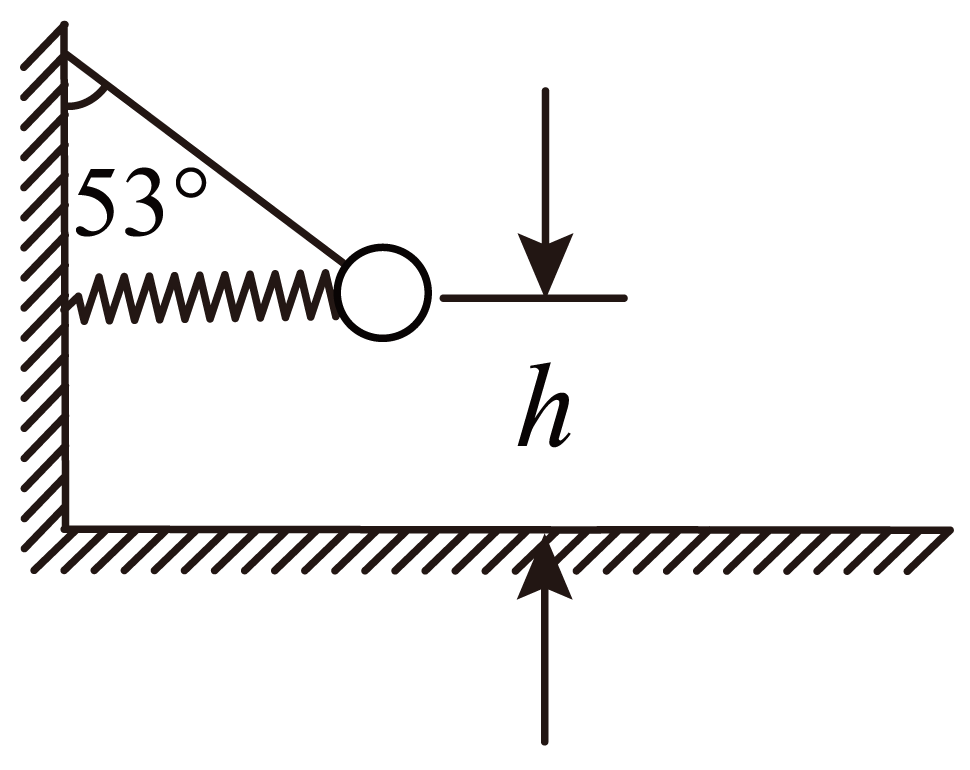

# Physics - 题目 361

**ID**: f2cee469c74a4991a0f7d67ffcad3c0c
**年级**: Grade 10
**难度**: Medium-Hard
**题型**: Multiple-choice

## 题目
细绳拴一个质量为m的小球，小球用固定在墙上的水平弹簧支撑，小球与弹簧不粘连，平衡时细绳与竖直方向的夹角为 $53{}^\circ $ ，如图所示以下说法正确的是（      ）​​​​​​​‌

## 解答

1. AB．小球静止时，分析受力情况，如图所示
2. 
3. 由平衡条件得弹簧的弹力大小为
4. $F=mg{\tan}53{}^\circ =\frac {4}{3}mg$
5. 细绳的拉力大小为
6. $T=\frac {mg}{{\cos}53{}^\circ }=\frac {5}{3}mg$
7. 故AB错误；
8. CD．细绳烧断瞬间弹簧的弹力不变，则小球所受的合力与烧断前细绳拉力的大小相等、方向相反，则此瞬间小球的加速度大小为
9. $a=\frac {T}{m}=\frac {5}{3}g$
10. 故C正确，D错误。
11. 故选C。
12. 【点睛】本题中小球先处于平衡状态，由平衡条件求解各力的大小，后烧断细绳，小球处于非平衡条件，抓住细绳烧断瞬间弹簧的弹力不变是关键。

## 知识点

**中文**:
  - 牛顿第二定律求解瞬时突变问题

**English**:
  - Solving Instantaneous Change Problems with Newton's 2nd Law

---
