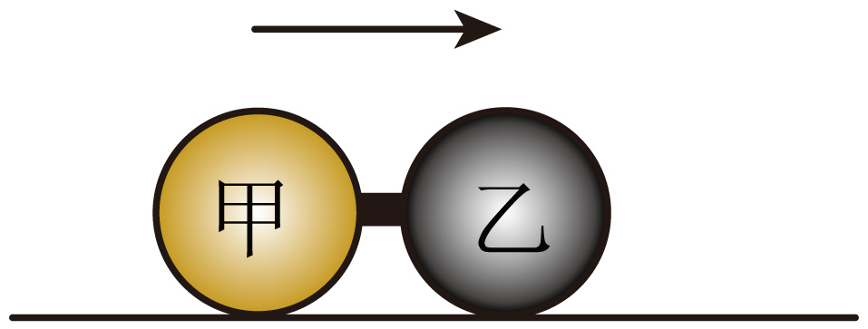

# Physics - 题目 728

**ID**: fdb45978701147a8a052a4434bf44460
**年级**: Grade 10
**难度**: Medium-Hard
**题型**: Multiple-choice

## 题目
如图所示，光滑水平面上甲、乙两球间粘少许炸药，一起以速度0.5m/s向右做匀速直线运动。​​​​​​​‌已知甲、乙两球质量分别为0.1kg和0.2kg。某时刻炸药突然爆炸，分开后两球仍沿原直线运动，从爆炸开始计时经过3.0s，两球之间的距离为x=2.7m，则说法正确的是（      ）

## 解答

1. 根据动量守恒定律有 $\left ({m{{}_{甲}}+m{{}_{乙}}}\right )v{{}_{0}}=m{{}_{甲}}v{{}_{1}}+m{{}_{乙}}v{{}_{2}}$ ，爆炸时间忽略不计，若爆炸后甲速度方向向左，此时 $v{{}_{1}}$ 为负值，则有 $v{{}_{2}}t-v{{}_{1}}t=x$ ，解得 $v{{}_{1}}=-0.1{\rm{m}}{\rm{/}}{\rm{s}}$ ， $v{{}_{2}}=0.8{\rm{m}}{\rm{/}}{\rm{s}}$ ，若爆炸后甲速度方向向右，此时 $v{{}_{1}}$ 为正值，则有 $v{{}_{2}}t-v{{}_{1}}t=x$ ，解得 $v{{}_{1}}=-0.1{\rm{m}}{\rm{/}}{\rm{s}}$ ， $v{{}_{2}}=0.8{\rm{m}}{\rm{/}}{\rm{s}}$ ，可知，爆炸后甲速度方向向右的情景不成立，即爆炸后甲速度方向向左，速度应取 $v{{}_{1}}=-0.1{\rm{m}}{\rm{/}}{\rm{s}}$ ， $v{{}_{2}}=0.8{\rm{m}}{\rm{/}}{\rm{s}}$ ，即分离时，甲、乙两球的速度方向相反，甲球的速度大小为0.1m/s，方向水平向左，A错误，B正确；结合上述可知，刚分离时，乙球的速度大小为0.8m/s，C错误；爆炸过程中释放的能量为 $E=\frac {1}{2}m{{}_{甲}}v{{}_{1}^{2}}+\frac {1}{2}m{{}_{乙}}v{{}_{2}^{2}}-\frac {1}{2}\left ({m{{}_{甲}}+m{{}_{乙}}}\right )v{{}_{0}^{2}}$ ，结合上述解得 $E=0.027{\rm{J}}{\rm ，D}$ 错误。

## 知识点

**中文**:
  - 爆炸问题

**English**:
  - Explosion Problems

---
