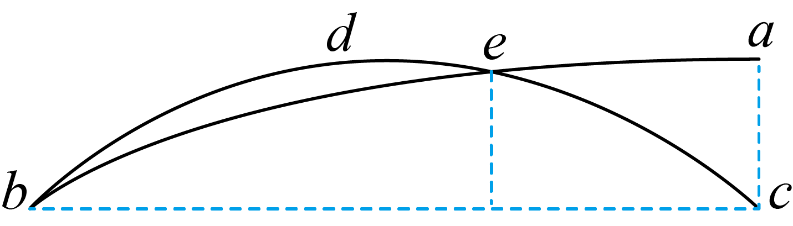

# Physics - 题目 895

**ID**: fee4cb66d9b4424c931c22a1b4570e64
**年级**: Grade 10
**难度**: Medium-Hard
**题型**: Multiple-choice

## 题目
如图所示，排球运动员第一次在 $a$ 点将排球水平击出，排球击中地面上的 $b$ 点；第二次在 $c$ 点将即将落地的排球斜向上击出，排球也击中 $b$ 点。​​​​​​​‌ $c$ 点在 $a$ 点的正下方，第二次排球运动的最高点 $d$ 与 $a$ 点等高，排球两次运动轨迹交点恰好为排球网上端点 $e$ 。不计空气阻力，下列说法正确的是（      ）

## 解答

1. 第二次排球运动的最高点d与a点等高，故比较第一次排球从a到b的过程和第二次排球从d到b的过程，这两个过程都做平抛运动，竖直方向做自由落体运动，下落高度一样，运动时间一样，根据运动的对称性可知，第二次从c到d的运动时间也等于第一次从a到b的运动时间，因此两次排球在空中运动时间不相等，A错误；设a到b的高度差为H，根据平抛运动规律可知，水平方向 $x{{}_{ab}}=v{{}_{a}}t{{}_{ab}}$ ，由题可知 $x{{}_{ab}}=2x{{}_{db}}=2v{{}_{d}}t$ ，解得 $v{{}_{a}}=2v{{}_{d}}$ ，竖直方向则有 $v{{}_{y}}=\sqrt {2gH}$ ，则第一次排球到达b点的速度为 $v{{}_{b}}=\sqrt {v{{}_{a}^{2}}+v{{}_{y}^{2}}}=\sqrt {4v{{}_{d}^{2}}+2gH}$ ，第二次排球到达b点的速度为 $v{{}_{b}}{^{\prime }}=\sqrt {v{{}_{d}^{2}}+v{{}_{y}^{2}}}=\sqrt {v{{}_{d}^{2}}+2gH}$ ，显然第一次排球到达b点的速度大于第二次排球到达b点的速度，B错误；如下图所示，由题可知，排球从a到f的时间和从d到g的时间相等，设为 $t^{′}$ ，根据上述分析可知 $v{{}_{a}}=2v{{}_{d}}$ ，则有 $x{{}_{ae}}=2x{{}_{de}}$ ，根据平抛运动的规律可知，从d点做平抛运动的物体，在 $x{{}_{de}}$ 和 $x{{}_{ae}}$ 所用的时间之比为 $1:2$ ，即 $t{{}_{ae}}=2t$ ，根据运动的独立性可知， $t{{}_{af}}:t{{}_{fc}}=1:2$ ，故有 $h{{}_{af}}=\frac {1}{2}gt{^{2}}$ ， $h{{}_{fc}}=\frac {1}{2}g(3t){^{2}}-\frac {1}{2}gt{^{2}}=4gt{^{2}}$ ，解得 $h{{}_{af}}:h{{}_{fc}}=1:8{\rm ，C}$ 正确；结合上图所示可知 $x{{}_{eb}}=x{{}_{db}}+x{{}_{de}}=x{{}_{de}}+x{{}_{ae}}+x{{}_{de}}$ ，结合上述结论 $x{{}_{ae}}=2x{{}_{de}}$ ，解得 $x{{}_{eb}}=4x{{}_{de}}$ ，则 $a$ 、 $e$ 两点的水平距离与 $e$ 、 $b$ 两点的水平距离之比为 $1:2{\rm ，D}$ 错误。
2. 

## 知识点

**中文**:
  - 斜抛运动

**English**:
  - Oblique Projectile Motion

---
