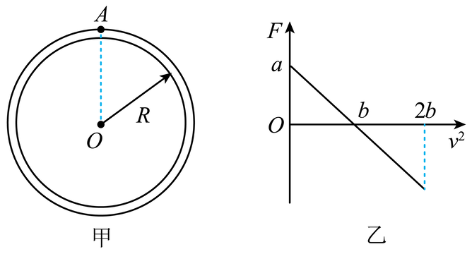

# Physics - 题目 1070

**ID**: 07f4cf87b5d542d18f2d03081b68eaf9
**年级**: Grade 10
**难度**: Medium-Hard
**题型**: Multiple-select

## 题目
如图甲所示，半径为R、内壁光滑的圆形细管竖直放置，一可看作质点的小球在圆管内做圆周运动，当其运动到最高点A时，小球受到的弹力F与其在A点速度平方(即v^{2})的关系如图乙所示．设细管内径可忽略不计，则下列说法中正确的是（      ）​​​​​​​‌

## 解答

1. 由图乙可知，当v^{2}＝b时，小球与圆管内壁之间恰好没有力的作用，此时由重力提供小球做圆周运动的向心力，即 $mg=m\frac {b}{R}$ ， $g=\frac {b}{R}{\rm ，A}$ 错误；当v^{2}＝0时，有mg＝a，又因为 $g=\frac {b}{R}$ ，所以小球的质量 $m=\frac {a}{b}R{\rm ，B}$ 正确；当v^{2}＝2b时，设小球运动到最低点时的速度大小为v′，则由机械能守恒定律可得： ${\rm \mathit{mg}·2\mathit{R}＝}\frac {1}{2}{\rm \mathit{mv}}$ ′ ${\rm ^{2}－}\frac {1}{2}{\rm \mathit{m}·2\mathit{b}}$ ，设小球在最低点时受到的弹力大小为F′，则由向心力公式可得： $F\prime -mg=m\frac {v^{′}{{^{2}}}}{R}$ ，联立解得：F′＝7a，C正确；当0≤v^{2}＜b时，小球在最高点时需要的向心力小于小球的重力，所以圆管对小球的弹力方向竖直向上，由牛顿第三定律可知，小球对圆管的弹力方向竖直向下，D错误．所以BC正确，AD错误。

## 知识点

**中文**:
  - 竖直面内圆周运动问题
  - 绳、杆类圆周运动问题

**English**:
  - Circular Motion in Vertical Plane
  - String and Rod Circular Motion Problems

---
