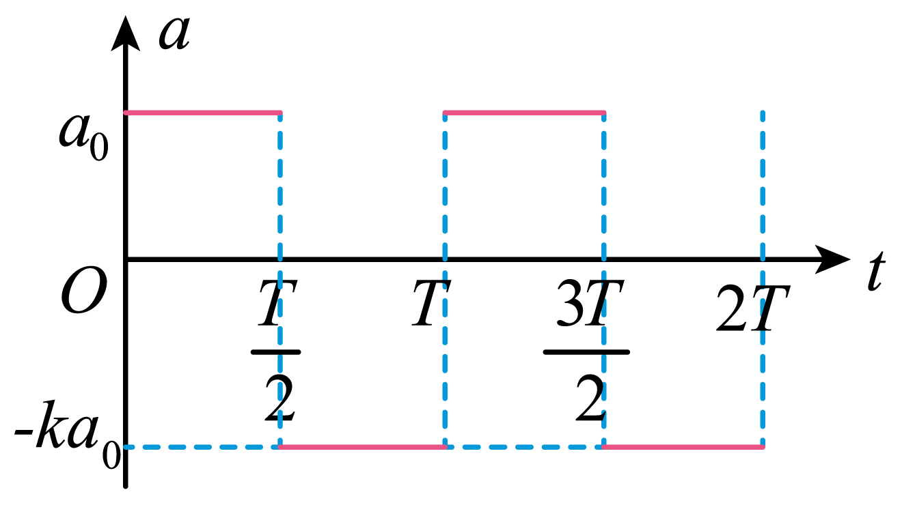

# Physics - 题目 303

**ID**: 0880106848a642539c558fa8f59c660c
**年级**: Grade 10
**难度**: Medium-Hard
**题型**: Multiple-select

## 题目
一质点从静止开始做直线运动，其加速度随时间的变化关系如图，图中 $a{{}_{0}}$ 、T、k均已知。​​​​​​​‌则（      ）

## 解答

1. A．若 ${\rm \mathit{k}=1，}\frac {T}{2}$ 末的速度大小为 $v=a{{}_{0}}\frac {T}{2}{\rm ，0}$ 到 $\frac {T}{2}$ 内的位移为 $s{{}_{1}}=\frac {1}{2}a{{}_{0}}{\left({\frac {T}{2}}\right)^{2}}=\frac {1}{8}a{{}_{0}}T{^{2}}$ ，同理 $\frac {T}{2}$ 到 $T$ 质点的位移为 $s{{}_{2}}=\frac {1}{8}a{{}_{0}}T{^{2}}{\rm ，0}$ 到T的位移为 $s=s{{}_{1}}+s{{}_{2}}=\frac {1}{4}a{{}_{0}}T{^{2}}{\rm ，A}$ 错误；
2. B．若 ${\rm \mathit{k}=2，}\frac {T}{2}$ 末的速度大小为 $v=a{{}_{0}}\frac {T}{2}{\rm ，\mathit{T}}$ 末质点的速度为 $v{{}_{1}}=v-2a{{}_{0}}\times \frac {T}{2}=-\frac {a{{}_{0}}T}{2}$ ， $\frac {3T}{2}$ 末的速度大小为 $v{{}_{2}}=-\frac {a{{}_{0}}T}{2}+\frac {a{{}_{0}}T}{2}=0{\rm ，2\mathit{T}}$ 末质点的速度为 $v{{}_{3}}=-2a{{}_{0}}\times \frac {T}{2}=-a{{}_{0}}T$ ，往复循环，由此可知NT(N=1，2，3…)时质点的速度为 $-\frac {Na{{}_{0}}T}{2}{\rm ，B}$ 错误；
3. C．质点加速度时间图像的面积表示速度增量，因此，质点在每个周期内前半个周期速度变化量 $\Delta v{{}_{1}}=a{{}_{0}}\times \frac {T}{2}$ ，后半个周期速度变化量 $\Delta v{{}_{2}}=-ka{{}_{0}}\times \frac {T}{2}$ ，因为 $6.5T=6T+\frac {T}{2}$ ，则 $6.5T$ 末速度为 $v{{}_{6.5T}}=\frac {\left ({7-6k}\right )}{2}a{{}_{0}}T{\rm ，C}$ 正确；
4. D．由题意，第N个周期内质点位移为零，有 $\frac {v{{}_{N-1}}+v{{}_{N-\frac {1}{2}}}}{2}\times \frac {T}{2}+\frac {v{{}_{N}}+v{{}_{N-\frac {1}{2}}}}{2}\times \frac {T}{2}=0$ ，将 $k=\frac {39}{37}$ 代入数据可得 $N=10{\rm ，D}$ 正确。选CD。

## 知识点

**中文**:
  - 非常规图像问题

**English**:
  - Non-standard Graph Problems

---
