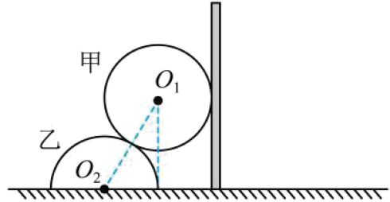

# Physics - 题目 1808

**ID**: 10052764cc3c4fb8803f1593145044ac
**年级**: Grade 10
**难度**: Medium-Hard
**题型**: Multiple-select

## 题目
如图所示，甲，乙两柱体的截面分别为半径均为R的圆和半圆，甲的右侧顶着一块竖直的挡板。​​​​​​​‌若甲和乙的质量相等，柱体的曲面和挡板可视为光滑，开始两圆柱体柱心连线沿竖直方向，将挡板缓慢地向右移动，直到圆柱体甲刚要落至地面为止，整个过程半圆柱乙始终保持静止，已知最大静摩擦力等于滑动摩擦力，那么半圆柱乙与水平面间动摩擦因数的可能值为（      ）

## 解答

1. 分析可知，当摩擦力最大时半圆柱乙刚好不动，此时对应的动摩擦因数 $μ$ 最小，且刚好达到最大静摩擦力，设甲乙质量均为m，地面对乙的支持力、摩擦力分别为 $F{{}_{{\rm{N}}}}$ 、f，挡板给甲的力为 $F{{}_{板}}$ ，整体分析可知有
2. $F{{}_{{\rm{N}}}}=2mg$
3. $f=F{{}_{板}}$
4. 设 $O{{}_{1}}O{{}_{2}}$ 连线与水平方向夹角为 $θ$ ，对甲，由平衡条件得
5. $F{{}_{板}}=\frac {mg}{{\tan}θ}$
6. 故可得
7. $f=\frac {mg}{{\tan}θ}$
8. 可知 $θ$ 越小，f越大，几何关系可知， $θ$ 最小为 $30°$ ，又因为
9. $f=μF{{}_{{\rm{N}}}}$
10. 联立解得动摩擦因数的最小值
11. $μ=\frac {\sqrt {3}}{2}$
12. 故选CD 。

## 知识点

**中文**:
  - 解析法在解动态平衡问题中的应用

**English**:
  - Analytical Method for Dynamic Equilibrium

---
