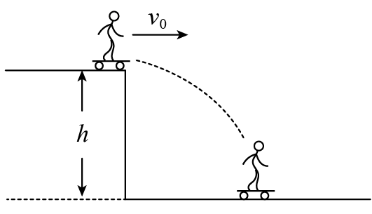

# Physics - 题目 1664

**ID**: 11a7e24264494fe9bdb6bd25b795aee9
**年级**: Grade 10
**难度**: Medium-Hard
**题型**: Multiple-select

## 题目
如图所示，滑板运动员以速度v_{0}从离地高度h处的平台末端水平飞出，落在水平地面上。​​​​​​​‌忽略空气阻力，运动员和滑板可视为质点．下列说法中正确的是（      ）

## 解答

1. A．运动员和滑板做平抛运动，在竖直方向有
2. $h=\frac {1}{2}gt{^{2}}$
3. 解得
4. $t=\sqrt {\frac {2h}{g}}$
5. 故运动员运动时间与初速度无关。故A错误；
6. B．根据动能定理得
7. $mgh=\frac {1}{2}mv{^{2}}-\frac {1}{2}mv{{}_{0}^{2}}$
8. 解得
9. $v=\sqrt {v{{}_{0}^{2}}+2gh}$
10. 可知运动员的v_{0}越大，运动员落地瞬间速度越大。故B正确；
11. C．在水平方向匀速运动，则水平射程
12. $x=v{{}_{0}}t=v{{}_{0}}\sqrt {\frac {2h}{g}}$
13. 则运动员落地位置与v_{0}大小和h大小都有关，h越大，运动员落地位置离平台越远。故C正确；
14. D．运动员落地瞬间速度与水平方向夹角的正切值
15. ${\tan}θ=\frac {v{{}_{y}}}{v{{}_{0}}}=\frac {gt}{v{{}_{0}}}=\frac {\sqrt {2gh}}{v{{}_{0}}}$
16. 可知h越大则tanθ越大，θ越大。故D正确。
17. 故选BCD。

## 知识点

**中文**:
  - 求解平抛运动、类平抛运动问题

**English**:
  - Solving Horizontal and Quasi-Horizontal Projectile Problems

---
