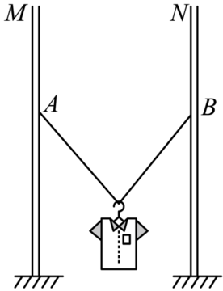

# Physics - 题目 2106

**ID**: 1895ea72906b42cfa2a5005e34182e2a
**年级**: Grade 10
**难度**: Medium-Hard
**题型**: Multiple-select

## 题目
如图所示，轻质不可伸长的晾衣绳两端分别固定在竖直杆M、N上的A、B两点，悬挂衣服的衣架钩是光滑的，开始A、B等高，绳子长度是两杆距离的两倍，绳的右端匀速上移较小的距离x的过程中，下列说法正确的是（      ）​​​​​​​‌

## 解答

1. 由题得绳子两端的拉力始终相等，衣服移动后如下图
2. 
3. 绳子和竖直方向的夹角不变，根据竖直方向始终平衡
4. $2T{\cos}θ=mg$
5. 水平方向始终平衡
6. $T\sin θ=T\sin θ$
7. 衣服始终处于平衡状态，衣服做匀速运动；根据几何关系可知：在 $\mathrm{△}BCD$ 中， $θ=30{}\degree $ ，在 $\vartriangle EFG$ 中， $\angle EFG$ 和 $∠EGF$ 均等于 $30{}\degree $ ，衣服移动距离
8. $EF=\frac {FG}{2}\times \frac {1}{{\cos}30{}\degree }=\frac {BB^{′}}{2}\times \frac {1}{{\cos}30{}\degree }=\frac {\sqrt {3}}{3}x$
9. 故AC错误，BD正确。
10. 故选BD。

## 知识点

**中文**:
  - 解析法在解动态平衡问题中的应用

**English**:
  - Analytical Method for Dynamic Equilibrium

---
