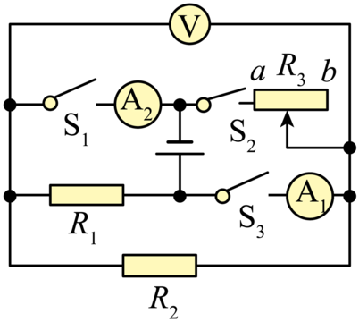

# Physics - 题目 46

**ID**: 1a8af96961884794822b308112fa3bb2
**年级**: Grade 10
**难度**: Medium-Hard
**题型**: Multiple-select

## 题目
如图所示电路，电源电压恒定不变，定值电阻 $R{{}_{1}}$ 与 $R{{}_{2}}$ 阻值相同。​​​​​​​‌让滑动变阻器 $R{{}_{3}}$ 的滑片位于中点，只闭合开关 ${\rm{S}}{{}_{2}}$ 时，电压表V的示数为2V；开关 ${\rm{S}}{{}_{2}}$ 、 ${\rm{S}}{{}_{3}}$ 闭合， ${\rm{S}}{{}_{1}}$ 断开时，电流表 ${\rm{A}}{{}_{1}}$ 的示数为0.2A。将 $R{{}_{3}}$ 的滑片移到b端，三个开关都闭合时，电流表 ${\rm{A}}{{}_{2}}$ 的示数为0.4A，电路消耗的总功率为 $P{{}_{1}}$ ；开关 ${\rm{S}}{{}_{1}}$ 、 ${\rm{S}}{{}_{2}}$ 闭合， ${\rm{S}}{{}_{3}}$ 断开时，电路消耗的总功率为 $P{{}_{2}}$ 。下列结果正确的是（      ）

## 解答

1. AB．开关 ${\rm{S}}{{}_{2}}$ 、 ${\rm{S}}{{}_{3}}$ 闭合， ${\rm{S}}{{}_{1}}$ 断开时，滑动变阻器 $R{{}_{3}}$ 的滑片位于中点， $R{{}_{1}}$ 与 $R{{}_{2}}$ 被短路，电路中只有 $\frac {1}{2}R{{}_{3}}$ ，电流表 ${\rm{A}}{{}_{1}}$ 的示数为0.2A，则电源电压
2. $U=\frac {1}{2}R{{}_{3}}\times 0.2{\rm{A}}$
3. 当三个开关都闭合时， $R{{}_{1}}$ 、 $R{{}_{2}}$ 与 $R{{}_{3}}$ 并联，电流表 ${\rm{A}}{{}_{2}}$ 测通过 $R{{}_{1}}$ 、 $R{{}_{2}}$ 两条支路的总电流，电流表 ${\rm{A}}{{}_{2}}$ 的示数为0.4A，由于定值电阻 $R{{}_{1}}$ 与 $R{{}_{2}}$ 阻值相同，由并联分流可知，通过 $R{{}_{1}}$ 、 $R{{}_{2}}$ 的电流均为0.2A，则电源电压
4. $U=0.2{\rm{A}}\times R{{}_{1}}=0.2{\rm{A}}\times R{{}_{2}}$
5. 联立解得
6. $R{{}_{1}}=R{{}_{2}}=\frac {1}{2}R{{}_{3}}$
7. 只闭合开关 ${\rm{S}}{{}_{2}}$ 时， $R{{}_{1}}$ 、 $R{{}_{2}}$ 与 $\frac {1}{2}R{{}_{3}}$ 串联，电压表测量 $R{{}_{2}}$ 两端电压，电压表V的示数为2V，由串联分压特点可知
8. $U{{}_{{\rm{R}}1}}=U{{}_{{\rm{R}}2}}=U{{}_{\frac {1}{2}{\rm{R}}3}}=2{\rm{V}}$
9. 则电源电压
10. $U=U{{}_{{\rm{R}}1}}+U{{}_{{\rm{R}}2}}+U{{}_{\frac {1}{2}{\rm{R}}3}}=2{\rm{V}}+$  $2{\rm{V}}+2{\rm{V}}=6{\rm{V}}$
11. 联立解得
12. $R{{}_{3}}=60Ω$
13. 故A错误，B正确；
14. C．将 $R{{}_{3}}$ 的滑片移到b端，三个゙开关都闭合时， $R{{}_{1}}$ 、 $R{{}_{2}}$ 与 $R{{}_{3}}$ 并联，电路消耗的总功率
15. $P{{}_{1}}=\frac {U{^{2}}}{R{{}_{1}}}+\frac {U{^{2}}}{R{{}_{2}}}+\frac {U{^{2}}}{R{{}_{3}}}=\frac {{\left({6{\rm{V}}}\right)^{2}}}{30{\rm{Ω}}}+\frac {{\left({6{\rm{V}}}\right)^{2}}}{30{\rm{Ω}}}+\frac {{\left({6{\rm{V}}}\right)^{2}}}{60{\rm{Ω}}}=3{\rm{W}}$
16. 故C正确；
17. D．开关 ${\rm{S}}{{}_{1}}$ 、 ${\rm{S}}{{}_{2}}$ 闭合， ${\rm{S}}{{}_{3}}$ 断开时， $R{{}_{2}}$ 、 $R{{}_{3}}$ 短路，电路中只有 $R{{}_{1}}$ ，电路消耗的总功率
18. $P{{}_{2}}=\frac {U{^{2}}}{R{{}_{1}}}=\frac {(6{\rm{V}}){^{2}}}{30Ω}=1.2{\rm{W}}$
19. 故D错误。选BC。

## 知识点

**中文**:
  - 电路的动态分析问题

**English**:
  - Dynamic Circuit Analysis

---
