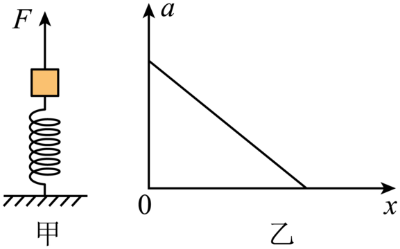

# Physics - 题目 2267

**ID**: 212d346ca5ee4e5da3556b16c22000ab
**年级**: Grade 10
**难度**: Medium-Hard
**题型**: Multiple-select

## 题目
如图甲所示，质量为m的物块静止在竖直放置的轻弹簧上（物块与弹簧不相连），弹簧下端固定，劲度系数为k。​​​​​​​‌t=0时刻，对物块施加一竖直向上的外力F，使物块由静止向上运动，当弹簧第一次恢复原长时，撤去外力F。从0时刻到F撤去前，物块的加速度a随位移x的变化关系如图乙所示。重力加速度为g，忽略空气阻力，在物块上升阶段，下列说法正确的是（      ）

## 解答

1. A．根据图像可知，F撤去前瞬间，加速度为零， $F=mg$ ，初始时 $kx{{}_{0}}=mg$ ，对物块有 $F+k(x{{}_{0}}-x)-mg=ma$ ，根据图像可知，a与x成正比，所以F为恒力，A正确；
2. B．初始时刻加速度最大，为 $a=\frac {F+kx{{}_{0}}-mg}{m}=g{\rm ，B}$ 错误；
3. C．从初始到物体脱离弹簧，根据速度位移公式 $v{^{2}}=2ax$ ，可知a-x图象围成的面积表示 $\frac {1}{2}v{^{2}}$ ，则有 $\frac {1}{2}v{^{2}}=\frac {1}{2}ax{{}_{0}}=\frac {1}{2}gx{{}_{0}}$ ，从脱离弹力到最高点，根据动能定理有 $-mgh=0-\frac {1}{2}mv{^{2}}$ ，联立解得外力F撤去后物块可以继续上升的最大高度为 $h=\frac {mg}{2k}{\rm ，C}$ 正确；
4. D．从初始到物体脱离弹簧，根据功能关系有 $E{{}_{{\rm{p}}}}-mgx{{}_{0}}+Fx{{}_{0}}=\frac {1}{2}mv{^{2}}$ ，解得 $E{{}_{{\rm{p}}}}=\frac {m{^{2}}g{^{2}}}{2k}{\rm ，D}$ 错误。选AC。

## 知识点

**中文**:
  - 应用动能定理求解与图像相关的动能问题
  - 运动过程分析、多过程问题

**English**:
  - Graph-related Kinetic Energy Problems
  - Analysis of Motion Process and Multi-process Problems

---
