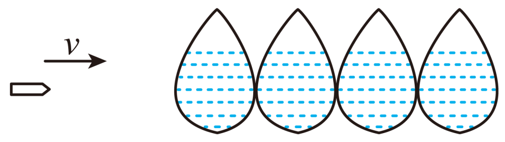

# Physics - 题目 2891

**ID**: 297aec7c29564221be089d3ca95418d8
**年级**: Grade 10
**难度**: Medium-Hard
**题型**: Multiple-select

## 题目
《国家地理》实验证实：四个水球就足够了！四个完全相同的水球紧挨在一起水平排列，假设子弹在水球中沿水平方向做匀变速直线运动。​​​​​​​‌恰好能穿出第四个水球，则（      ）

## 解答

1. 四个完全相同的水球紧挨在一起水平排列，子弹在水球中沿水平方向做匀变速直线运动。恰好能穿出第四个水球，逆向思维可看成反向初速度为零的匀加速直线运动，设每个水滴的厚度为d，根据匀变速直线运动的规律 $x=\frac {1}{2}at{^{2}}$ ，可得 $t\propto \sqrt {x}$ ，子弹依次穿过4个水球的时间之比为 $t{{}_{1}}:t{{}_{2}}:t{{}_{3}}:t{{}_{4}}=(\sqrt {4d}-\sqrt {3d}):(\sqrt {3d}-\sqrt {2d}):(\sqrt {2d}-\sqrt {d}):\sqrt {d}=(2-\sqrt {3}):(\sqrt {3}-\sqrt {2}):(\sqrt {2}-1):1$ ，故AD正确；同理根据逆向思维，结合初速为零匀变速直线运动规律 $v{^{2}}=2ax$ ，可得 $v\propto \sqrt {x}$ ，子弹依次进入每个小球时的速度之比为 $v{{}_{1}}:v{{}_{2}}:v{{}_{3}}:v{{}_{4}}=\sqrt {4d}:\sqrt {3d}:\sqrt {2d}:\sqrt {d}=2:\sqrt {3}:\sqrt {2}:1$ ，故B正确；根据逆向思维及初速为零的匀变速直线运动的规律可得，子弹穿过第三个水滴的时间 $t{{}_{3}}=\sqrt {\frac {2d}{a}}$ ，子弹穿过四个水滴的总时间 $t=\sqrt {\frac {2\times 4d}{a}}=2\sqrt {\frac {2d}{a}}=2t{{}_{3}}$ ，即子弹穿出第三个水球的时间与恰好为穿出四个水球的时间的一半，根据匀变速直线运动中间时刻的瞬时速度等于全程的平均速度，可知子弹穿出第三个水球的瞬时速度与全程的平均速度相等，故C错误。

## 知识点

**中文**:
  - 匀变速直线运动重要推论的应用
  - 逆向思维法在匀变速直线运动中的应用

**English**:
  - Applications of Important UVRM Corollaries
  - Reverse Thinking in UVRM Problems

---
