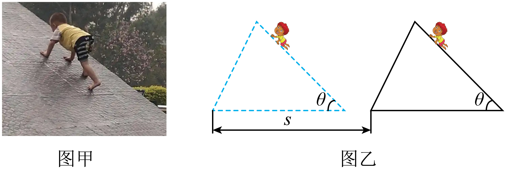

# Physics - 题目 297

**ID**: 335bdd496d2f4a4cb1721a42beab496a
**年级**: Grade 10
**难度**: Medium-Hard
**题型**: Multiple-select

## 题目
如图甲所示，在一个闯关游戏中，质量为 $m$ 的选手处于游戏道具的斜面上，斜面的倾角为 $θ$ ，选手与斜面间的动摩擦因数为 $μ$ ，道具在外力的作用下沿水平方向向右匀速移动一小段距离 $s$ ，选手相对于斜面始终静止。​​​​​​​‌重力加速度为 $g$ ，图乙是该过程的简化示意图，下列说法正确的是（      ）

## 解答

1. 选手竖直方向没有移动，重力对选手做功为0，A正确；选手处于游戏道具的斜面上，受力平衡，选手受静摩擦力沿斜面向上，根据平衡条件 $f=mg\sin θ$ ，斜面对选手的摩擦力做的功为 $W{{}_{{\rm{f}}}}=mg\sin θ·s·{\cos}\left ({π-θ}\right )=-mgs\sin θ{\cos}θ{\rm ，B}$ 错误；斜面对选手的支持力做的功为 $W{{}_{{\rm{N}}}}=Ns{\cos}\left ({90{}\degree -θ}\right )=mg\sin θ{\cos}θ{\rm ，C}$ 正确；斜面对选手的静摩擦力和支持力的合力与重力等大反向，竖直向上，与位移垂直，做的总功为0，D正确。选ACD 。

## 知识点

**中文**:
  - 功和功率
  - 功率的计算和估算

**English**:
  - Work and Power
  - Calculation and Estimation of Power

---
