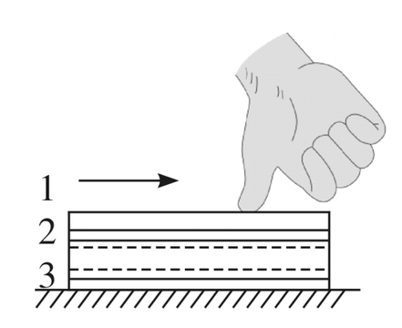

# Physics - 题目 1467

**ID**: 3af14b3510d149468f93aebe6b9807ba
**年级**: Grade 10
**难度**: Medium-Hard
**题型**: 有选错得0分）

## 题目
如图所示，水平桌面上平放一叠共计54张的扑克牌，每一张的质量均为 $m$ 。​​​​​​​‌ 用一手指以竖直向下的力压第1张牌，并以一定速度向右移动手指，确保手指与第1张牌之间有相对滑动。设最大静摩擦力与滑动摩擦力相同，手指与第1张牌之间的动摩擦因数为 ${\mathit{\mu }}_{1}$ ， 牌间的动摩擦因数均为 ${\mathit{\mu }}_{2}$ ， 第54张牌与桌面间的动摩擦因数为 ${\mathit{\mu }}_{3}$ ， 重力加速度为 $g$ ， 则下列说法正确的是（      ）

## 解答

1. 设手指竖直向下的压力为 $F$ ， 则手指与第1张牌之间的摩擦力为 $f={\mathit{\mu }}_{1}F$ ， 由于手指向右移动，并且与第1张牌之间有相对滑动，所以第1张牌受到手指的摩擦力向右，大小为 $f={\mathit{\mu }}_{1}F$ ， 当 ${\mathit{\mu }}_{1}={\mathit{\mu }}_{2}-{\mathit{\mu }}_{3}$ 时，第2张牌对第1张牌的最大静摩擦力为 ${f}_{\mathrm{\max }}={\mathit{\mu }}_{2}(F+{mg})>f$ ， 则第1张牌静止受到的摩擦力为静摩擦力，大小 ${\mathit{\mu }}_{1}F$ ， 以此类推，第1张牌到第54张牌均静止，受到的摩擦力均为静摩擦力，且静擦力大小为 ${\mathit{\mu }}_{1}F，\text{B}$ 错误；因牌间的动摩擦因数均为 ${\mathit{\mu }}_{2}$ ， 由分析可知，第2张牌到第53张牌均相对静止，之间不可能发生相对滑动，则A 错误。对第3张牌受力分析，第2张牌给第3张牌的静摩擦力方向向右， $C$ 正确，当 ${\mathit{\mu }}_{1}={\mathit{\mu }}_{3}{=1.5}{\mathit{\mu }}_{2}$ 时，第1张牌对第2张牌的压力为 $F+{mg}$ ， 它们之间的摩擦力为 ${f}_{1}={\mathit{\mu }}_{2}(F+{mg})=\frac{8}{3}{\mathit{\mu }}_{1}{mg}{<3}{\mathit{\mu }}_{1}{mg}$ ， 则第1张牌滑动，即第1张牌给第2张牌的摩擦力为 $\frac{8}{3}{\mathit{\mu }}_{1}{mg}$ 。 第3张牌给第2张牌的最大静摩擦力 ${f}_{\mathrm{\max }}^{\prime }={\mathit{\mu }}_{2}(F{+2}{mg})>\frac{8}{3}{\mathit{\mu }}_{1}{mg}$ ， 则第2张及以下的牌均静止，且受到的静摩擦力大小为 $\frac{8}{3}{\mathit{\mu }}_{1}{mg}$ ， D正确，故选 $\text{CD}$ ，

## 知识点

**中文**:
  - 静摩擦力有无的判定及静摩擦力的大小与方向

**English**:
  - Determination of Static Friction (Existence, Magnitude, Direction)

---
