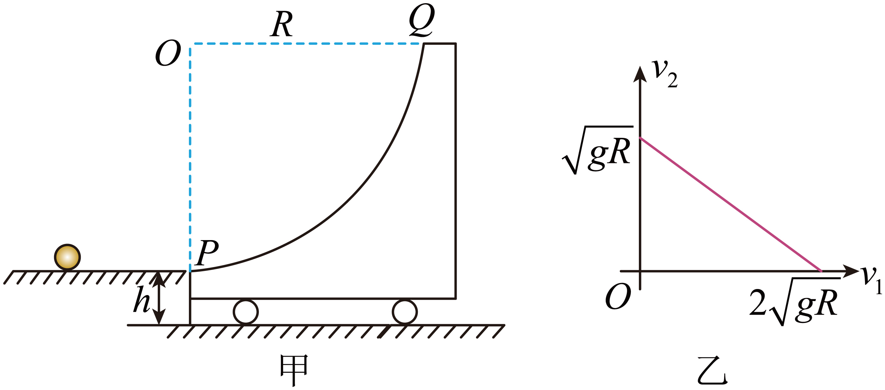

# Physics - 题目 458

**ID**: 408c91afb5ef40599b7c46c3a836aede
**年级**: Grade 10
**难度**: Medium-Hard
**题型**: Multiple-select

## 题目
如图甲，一质量为M的小车静止在光滑水平地面上，其左端P点与平台平滑连接。​​​​​​​‌小车上表面 $PQ$ 是以O为圆心、半径为R的四分之一圆弧轨道。质量为m的光滑小球，以某一水平速度冲上小车的圆弧面。若测得小球与小车在水平方向上的速度分量大小分别为 $v{{}_{1}}、v{{}_{2}}$ ，作出图像如图乙所示。已知 $OP$ 竖直， $OQ$ 水平，水平台面高 $h=\frac {R}{6}$ ，小球可视为质点，重力加速度为g，不计一切摩擦。则（      ）

## 解答

1. 根据题意可知，小球和小车组成的系统水平方向上不受外力，则系统水平方向动量守恒，由图乙可知，当v_{1}=0时， $v{{}_{2}}=\sqrt {gR}$ ，当v_{2}=0时， $v{{}_{1}}=2\sqrt {gR}$ ，取水平向右为正方向，由系统水平方向动量守恒有 $m\cdot 2\sqrt {gR}=M\sqrt {gR}$ ，解得M=2m，A正确；设小球上升的最大高度为h_{m}，小球在Q点速度为v_{Q}，小球在Q点时，水平方向与小车共速，取水平向右为正方向，由系统水平方向动量守恒有 $m\cdot 2\sqrt {gR}=\left ({m+M}\right )v{{}_{共}}$ ，解得 $v{{}_{共}}=\frac {2}{3}\sqrt {gR}$ ，小球由P点运动到最高点时，由系统机械能守恒有 $\frac {1}{2}m{\left({2\sqrt {gR}}\right)^{2}}=mgh{{}_{m}}+\frac {1}{2}\left ({m+M}\right )v{{}_{共}^{2}}$ ，解得 $h{{}_{m}}=\frac {4R}{3}{\rm ，B}$ 错误；因为球从小车右侧离开小车后与小车有共同的水平速度，可知小球最终还会落回到小车上，不会落到小车右侧水平面上，C错误；根据题意可知，小球从P点离开小车，设离开小车时，小球的速度为v_{3}，小车的速度为v_{4}，由系统水平方向动量守恒和机械能守恒有 $m\cdot 2\sqrt {gR}=mv{{}_{3}}+Mv{{}_{4}}$ ， $\frac {1}{2}m{\left({2\sqrt {gR}}\right)^{2}}=\frac {1}{2}mv{{}_{3}^{2}}+\frac {1}{2}Mv{{}_{4}^{2}}$ ，设小球落地速度为v_{5}，由机械能守恒定律有 $\frac {1}{2}mv{{}_{3}^{2}}+mgh=\frac {1}{2}mv{{}_{5}^{2}}$ ，联立解得 $v{{}_{5}}=\frac {\sqrt {7gR}}{3}{\rm ，D}$ 正确。

## 知识点

**中文**:
  - 人船模型

**English**:
  - Man-Boat Model

---
