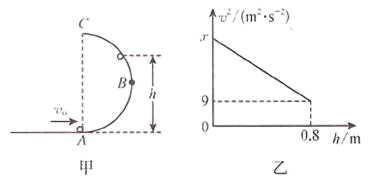

# Physics - 题目 1659

**ID**: 4301a43a898d424abb88ea3e7b17300a
**年级**: Grade 10
**难度**: Medium-Hard
**题型**: Multiple-select

## 题目
如图甲，在竖直平面内固定一光滑的半圆形轨道ABC，半径为0.​​​​​​​‌4m，小球以一定的初速度从最低点A冲上轨道，图乙是小球在半圆形轨道上从A运动到C的过程中，其速度平方与其对应高度的关系图像，已知小球在最高点C受到轨道的作用力为2.5N，空气阻力不计，B点为AC轨道中点，重力加速度g取10m/s^{2}，下列说法正确的是（      ）

## 解答

1. 小球在光滑轨道上运动，只有重力做功，机械能守恒，所以有 $\frac {1}{2}mv{{}_{A}^{2}}=\frac {1}{2}mv{{}_{C}^{2}}+mgh$ ，解得 $v{{}_{A}^{2}}=x=25{\rm{m}}{^{{{2}}}}{\rm{/}}{\rm{s}}{^{{{2}}}}{\rm ，A}$ 正确；由图乙可知，轨道半径R=0.4m，小球在C点的速度vC=3m/s，那么由牛顿第二定律可得 $F+mg=m\frac {v{{}_{C}^{2}}}{R}$ ，解得m=0.2kg，B正确；小球在A点时重力G=mg=0.2×10N=2N，方向向下；速度vA=5m/s，方向向右，小球在A点时重力的功率为0，C错误；由机械能守恒定律 $\frac {1}{2}mv{{}_{A}^{2}}=\frac {1}{2}mv{{}_{B}^{2}}+mgR$ ，可得在B点的速度为 $v{{}_{B}}=\sqrt {17}{\rm{m}}{\rm{/}}{\rm{s}}$ ，所以小球在B点受到的在水平方向上的合外力做向心力为 $F=m\frac {v{{}_{B}^{2}}}{R}=8.5{\rm{N}}$ ，所以小球在B点受到轨道作用力为8.5N，D错误。

## 知识点

**中文**:
  - 球杆模型圆周运动中机械能守恒定律的应用
  - 竖直面内圆周运动问题

**English**:
  - Rod-Ball Circular Motion Models
  - Circular Motion in Vertical Plane

---
