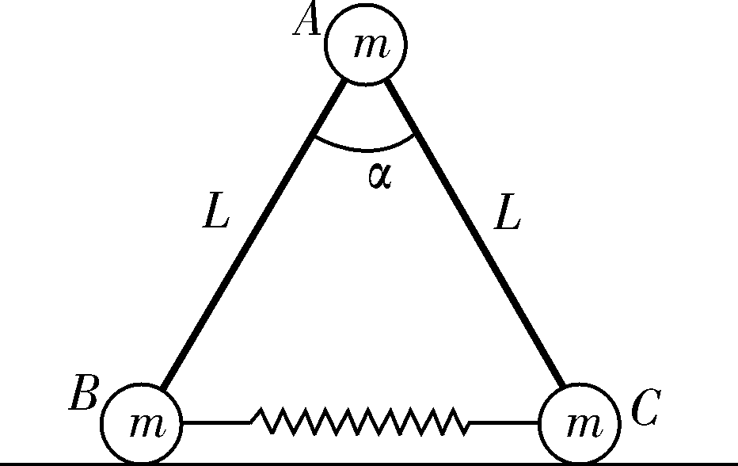

# Physics - 题目 632

**ID**: 51ff37c4f7134c4581bd65f1441bfacb
**年级**: Grade 10
**难度**: Medium-Hard
**题型**: Multiple-select

## 题目
如图所示，三个小球A、B、C的质量均为m，A与B、C间通过铰链用轻杆连接，杆长为L，B、C置于水平地面上，用一轻质弹簧连接，弹簧处于原长．现A由静止释放下降到最低点，两轻杆间夹角α由60°变为120°，A、B、C在同一竖直平面内运动，弹簧在弹性限度内，忽略一切摩擦，重力加速度为g.​​​​​​​‌则在此过程中

## 解答

1. A的动能最大时，设B和C受到地面的支持力大小均为F，此时整体在竖直方向受力平衡，可得2F=3mg，所以 $F=\frac {3}{2}mg$ ，在A的动能达到最大前一直是加速下降，处于失重情况，所以B受到地面的支持力小于 $\frac {3}{2}mg$ ，故AB正确；当A达到最低点时动能为零，此时弹簧的弹性势能最大，A的加速度方向向上，故C错误；A球达到最大动能后向下做减速运动，到达最低点时三个小球的动能均为零，由机械能守恒定律得，弹簧的弹性势能为E_{p}＝mg(Lcos  30°－Lcos 60°)＝ $E{{}_{P}}=\frac {\sqrt {3}-1}{2}mgL$ ，故D错误．所以AB正确，CD错误．

## 知识点

**中文**:
  - 弹性势能的变化与弹力做功的关系
  - 重力势能的变化与重力做功的关系

**English**:
  - Change in Elastic PE and Work Done by Elastic Force
  - Change in Gravitational PE and Work Done by Gravity

---
