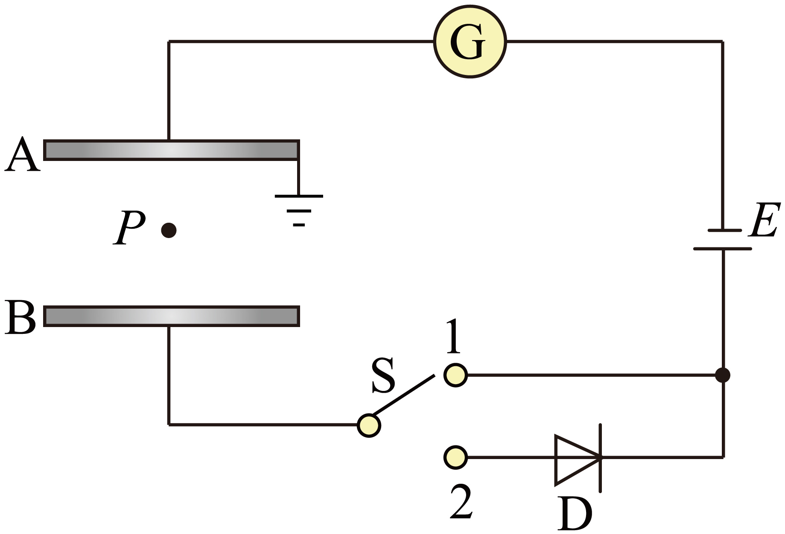

# Physics - 题目 495

**ID**: 52e1d1e5357446ba99ece4bf89fd24d9
**年级**: Grade 10
**难度**: Medium-Hard
**题型**: Multiple-select

## 题目
如图所示的电路中，两金属板沿水平方向放置，并与灵敏电流计G串联后接在电源两端，D是理想二极管。​​​​​​​‌单刀双掷开关S接1时，带电小球刚好静止在两极板间P点，A极板接地。下列说法正确的是（      ）

## 解答

1. 单刀双掷开关S接1时，AB板间电场强度方向竖直向上，带电小球刚好静止在两极板间，则小球所受电场力方向也是竖直向上，故小球带正电，A板接地，电势为零，AB板间电势都为正，根据电势能 $E{{}_{{\rm{p}}}}=qφ$ ，可知小球电势能为正，A错误；单刀双掷开关S接1时，电容器的电压E不变，仅将A板向上移动少许，板间距离变大，则电场强度E_{场强}变小，P点与B板电势差 $U{{}_{PB}}=Ed{{}_{PB}}$ 减小，又 $U{{}_{BP}}=φ{{}_{B}}-φ{{}_{P}}=E-φ{{}_{P}}$ ，可知 $φ{{}_{P}}$ 升高，B正确；单刀双掷开关S接2时，仅将B板向上移动少许，板间距离变小，但是由于二极管的单向导电性，电容器的电量不变，板间电场强度大小不变，小球仍保持静止，C错误；单刀双掷开关S空置，电容器电量不变，插入电介质，电容变大，由 $C=\frac {Q}{U}$ 可知，电压减小。极板之间的电场强度 $E{{}_{场强}}=\frac {U}{d}$ ，电容器电容 $C=\frac {Q}{U}=\frac {ε{{}_{{\rm{r}}}}S}{4πkd}$ ，联立解得 $E{{}_{场强}}=\frac {4πkQ}{ε{{}_{{\rm{r}}}}S}$ ，知插入电介质后场强E减小，小球向下运动，D正确。

## 知识点

**中文**:
  - 平行板电容器电容大小及其影响因素
  - 电势能与静电力做功

**English**:
  - Factors Affecting Capacitance of Parallel Plate Capacitors
  - Electric Potential Energy and Work Done by Electrostatic Force

---
