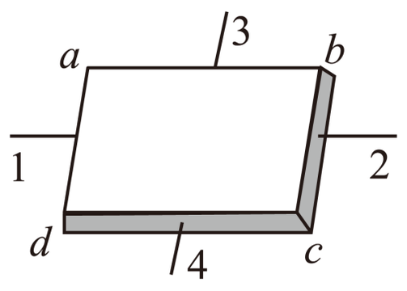

# Physics - 题目 1872

**ID**: 57e64c92310a493c9118b34c5c3e295f
**年级**: Grade 10
**难度**: Medium-Hard
**题型**: Multiple-select

## 题目
如图所示是厚度不变的均匀的长薄片合金电阻板abcd（电阻率不随温度变化），ab边长为 $L{{}_{1}}$ ，ad边长为 $L{{}_{2}}$ 。​​​​​​​‌设端点1、2接入电路中时的电阻阻值为 $R{{}_{12}}$ ，端点3、4接入电路中时的电阻阻值为 $R{{}_{34}}$ ，则ab下列说法正确的是（      ）

## 解答

1. AB．设电阻板的高度为d，当端点1、2接入电路时，根据电阻定律，电阻
2. $R{{}_{12}}=ρ\frac {L{{}_{1}}}{L{{}_{2}}d}$
3. 当端点3、4接入电路时，根据电阻定律，电阻
4. $R{{}_{34}}=ρ\frac {L{{}_{2}}}{L{{}_{1}}d}$
5. 则
6. $R{{}_{12}}:R{{}_{34}}=L{{}_{1}^{2}}:L{{}_{2}^{2}}$
7. 故A错误，B正确；
8. C．若将长薄片沿ab方向均匀拉长为原来的2倍
9. $R{{}_{12}}=ρ\frac {2L{{}_{1}}}{\frac {1}{2}L{{}_{2}}d}=ρ\frac {4L{{}_{1}}}{L{{}_{2}}d}$
10. $R{{}_{34}}=ρ\frac {\frac {1}{2}L{{}_{2}}}{2L{{}_{1}}d}=ρ\frac {L{{}_{2}}}{4L{{}_{1}}d}$
11. 则
12. $R{{}_{12}}:R{{}_{34}}=16L{{}_{1}^{2}}:L{{}_{2}^{2}}$
13. 故C错误；
14. D．若将长薄片沿ad方向均匀拉长为原来的2倍
15. $R{{}_{12}}=ρ\frac {L{{}_{1}}}{L{{}_{2}}d}=ρ\frac {\frac {1}{2}L{{}_{1}}}{2L{{}_{2}}d}=ρ\frac {L{{}_{1}}}{4L{{}_{2}}d}$
16. $R{{}_{34}}=ρ\frac {2L{{}_{2}}}{\frac {1}{2}L{{}_{1}}d}=ρ\frac {4L{{}_{2}}}{L{{}_{1}}d}$
17. 则
18. $R{{}_{12}}:R{{}_{34}}=L{{}_{1}^{2}}:16L{{}_{2}^{2}}$
19. 故D正确。
20. 故选BD。

## 知识点

**中文**:
  - 电阻定律

**English**:
  - Law of Resistance

---
