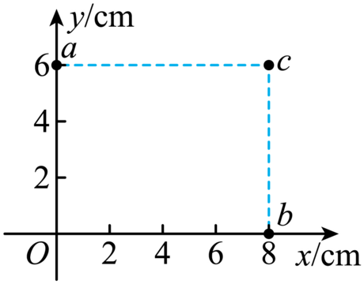

# Physics - 题目 1111

**ID**: 5d494db566ec44059795705a463f0d0c
**年级**: Grade 10
**难度**: Medium-Hard
**题型**: Multiple-select

## 题目
一匀强电场的方向平行于xOy平面，平面内a、b、c三点的位置如图所示，三点的电势分别为10V、17V、26V。​​​​​​​‌下列说法正确的是（      ）

## 解答

1. 
2. B．因为是匀强电场，ac与Ob平行，故电势差相等，原点O的电势为1V，B正确；
3. A．Ob的电势差为16V，故x轴上电势差为2V/cm，则坐标x=4.5的点的电势为10V，连接该坐标点与a点。该连接线即为一个等势面。做Od垂直于该等势面，从几何知识可以得到，Od=3.6cm，则
4. $E=\frac {U}{d}=\frac {10-1}{3.6}{{\rm{V}}}/{{\rm{c}}{\rm{m}}}=2.5{{\rm{V}}}/{{\rm{c}}{\rm{m}}}$
5. A正确；
6. C．a点电势比b点电势小，电子带负电，根据 $E=φq$ 可知，a点电势能反而大，C错误；
7. D．根据电场力做功公式
8. $W{{}_{bc}}=\Delta E{{}_{{\rm{p}}}}=U{{}_{bc}}q=(φ{{}_{b}}-φ{{}_{c}})(-e)=9{\rm{e}}{\rm{V}}$
9. b到c，电势增加9V，电子带负电，电势能降低9eV，所以电子从b到c的过程中，电势能降低，电场力做正功，9eV，D正确；
10. 故选ABD。

## 知识点

**中文**:
  - 匀强电场中电势差与电场强度的关系
  - 电势差与等势面的综合性问题

**English**:
  - U=Ed in Uniform Electric Field
  - Comprehensive Problems on Potential Difference and Equipotential Surfaces

---
