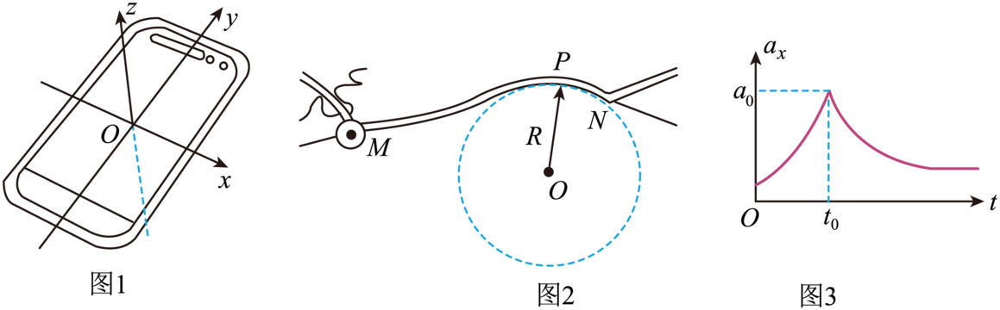

# Physics - 题目 258

**ID**: 5ed119589d144a87941d437950169bd7
**年级**: Grade 10
**难度**: Medium-Hard
**题型**: Multiple-select

## 题目
在外出研学途中，小明把手机平放在火车卧铺床位上，研究火车通过铁路弯道的运动情况。​​​​​​​‌如图1，手机的x轴与火车前进方向垂直，y轴与火车前进方向一致，z轴垂直床位即车厢底板。如图2，地图软件显示火车即将进入一处明显的转弯路段，从火车在M点进入路段至N点离开，车厢内的信息屏显示车速始终为v=118km/h。小明使用手机测量并记录下火车在这一路段x轴方向的加速度a_{x}随时间t的变化关系图像如图3所示。t_{0}时刻火车刚好经过弯道的P点处（该处铁轨平面倾角为θ），P点附近火车的运动可视为水平面内圆周运动的一部分。下列说法正确的是（      ）

## 解答

1. 根据题意可知，y轴与火车前进方向一致，且该方向火车的车速始终为v=118km/h，即沿y轴方向合力为0，则在MN路段间火车沿y轴的加速度始终保持为零，A正确；手机平放在火车卧铺床位上，z轴垂直床位即车厢底板，根据题意，当火车刚好经过弯道的P点时，P点附近火车的运动可视为水平面内圆周运动的一部分，火车此时做匀速圆周运动，该处铁轨平面倾角为θ，根据牛顿第二定律，此时向心加速度 $a=\frac {v{^{2}}}{R}$ ，根据图3有 $a{{}_{x}}=a{{}_{0}}$ ，向心加速度等于x、z轴方向加速度的矢量和，根据矢量合成规律可知，此时有 $a{{}_{z}}=a{{}_{x}}{\tan}θ$
2. 解得 $a{{}_{z}}=a{{}_{0}}{\tan}θ$ ，即在MN路段间火车沿z轴的加速度不一定始终保持为零，B错误；P点附近火车的运动可视为水平面内圆周运动的一部分，结合上述 $a{\cos}θ=a{{}_{x}}$ ，解得 $\frac {a{{}_{0}}}{{\cos}θ}=\frac {v{^{2}}}{R}{\rm ，C}$ 错误，D正确。

## 知识点

**中文**:
  - 运动的合成与分解

**English**:
  - Composition and Resolution of Motion

---
