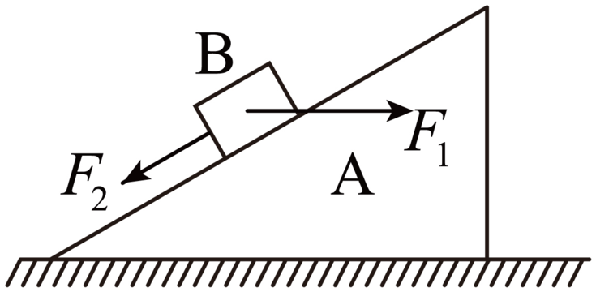

# Physics - 题目 1679

**ID**: 60fc67c62b854256a8b54c7517008f8a
**年级**: Grade 10
**难度**: Medium-Hard
**题型**: Multiple-select

## 题目
如图所示，斜面体A静止在水平面上，质量为m的滑块B在外力 $F{{}_{1}}$ 和 $F{{}_{2}}$ 的共同作用下沿斜面向下运动，当 $F{{}_{1}}$ 方向水平向右， $F{{}_{2}}$ 方向沿斜面向下时，地面对斜面体摩擦力的方向水平向左，则下列说法正确的是（      ）​​​​​​​‌

## 解答

1. 当斜劈A表面光滑（设斜面的倾角为θ，A的质量为m_{A}，B的质量为m_{B}），对A分析有
2. 
3. A．撤去 $F{{}_{1}}$ 前有 $f=\left ({m{{}_{B}}g{\cos}θ+F{{}_{1}}\sin θ}\right )\sin θ$ ，如果撤去 $F{{}_{1}}$ ，使A相对地面发生相对运动趋势的外力大小是 $F{{}_{N2}}\sin θ=m{{}_{B}}g{\cos}θ\sin θ$ ，因为 $m{{}_{B}}g{\cos}θ\sin θ<\left ({m{{}_{B}}g{\cos}θ+F{{}_{1}}\sin θ}\right )\sin θ$ ，所以A所受地面的摩擦力仍然是静摩擦力，为 $f^{′}=m{{}_{B}}g{\cos}θ\sin θ$ ，其方向仍然是向左而不可能向右，A错误；
4. B．如果撤去 $F{{}_{2}}$ ，在物体B仍向下运动的过程中，使A相对地面有向右滑动趋势的外力是 $F=\left ({m{{}_{B}}g{\cos}θ+F{{}_{1}}\sin θ}\right )\sin θ$ ，与 $F{{}_{2}}$ 是否存在无关；所以撤去 $F{{}_{2}}$ ，在物体B仍向下运动的过程中，A所受地面的摩擦力应该保持不变，方向仍然向左，B错误；
5. C．由A选项的分析可知只撤去 $F{{}_{1}}$ ，在滑块B仍向下运动的过程中，A所受地面摩擦力减小；故C正确；
6. D．若同时撤去 $F{{}_{1}}$ 和 $F{{}_{2}}$ ，滑块B沿斜面方向只有沿斜面向下的重力的分力。故合力方向一定沿斜面向下，D正确。
7. 当斜劈A上表面粗糙时（设A表面的动摩擦因数为μ），在斜劈A表面粗糙的情况下，B在F_{1}、F_{2}共同作用下沿斜面向下的运动就不一定是匀加速直线运动，也可能是匀速直线运动。
8. 根据题意知在B沿斜劈下滑时，受到A对它弹力F_{N}和滑动摩擦力f_{1}，根据牛顿第三定律，这两个力反作用于A，斜劈A实际上就是在这两个力的水平分力作用下有相对地面向右运动的趋势的，所以 $F{{}_{N}}\sin θ>f{{}_{1}}{\cos}θ$ ，又因为所以 $F{{}_{N}}\sin θ>μF{{}_{N}}{\cos}θ$ ，即 $μ<{\tan}θ$
9. A．如果撤去F_{1}，在物体B仍向下运动的过程中，有 $f{{}_{1}}=μF{{}_{N}}={\rm μm}{{}_{B}}g{\cos}θ$ ，假设此时A受的摩擦力f_{A}方向向左，则 $F{{}_{N}}\sin θ=f{{}_{1}}{\cos}θ+f{{}_{A}}$ ，即 $f{{}_{A}}=F{{}_{N}}\sin θ-μF{{}_{N}}{\cos}θ=F{{}_{N}}(\sin θ-μ{\cos}θ)>0$ ，所以假设成立斜劈A有相对地面向右运动的趋势，摩擦力方向是向左，A错误；
10. B．无论A表面是否粗糙，F_{2}的存在与否对斜劈受地面摩擦力大小和方向都没有影响，撤去F_{2}后，斜劈A所受摩擦力大小和方向保持不变，仍向左，B错误；
11. C．撤去F_{1}前有 $F{{}_{N}}=μ\left ({m{{}_{B}}g{\cos}θ+F{{}_{1}}\sin θ}\right )$ ，结合A选项分析可知撤去F_{1}后F_{N}变小，f_{A}变小，C正确；
12. D．同时撤出F_{1}和F_{2}，由以上分析可以知道 $m{{}_{B}}g\sin θ>{\rm μm}{{}_{B}}g{\cos}θ$ ，所以物体B所受的合力沿斜面向下，D正确。
13. 综上分析可知无论斜劈A上表面是否光滑CD均正确，AB均错误。选CD。

## 知识点

**中文**:
  - 受力分析
  - 在共点力平衡中整体法与隔离法的应用
  - 解析法在解动态平衡问题中的应用

**English**:
  - Force Analysis
  - Whole and Isolation Methods in Equilibrium
  - Analytical Method for Dynamic Equilibrium

---
