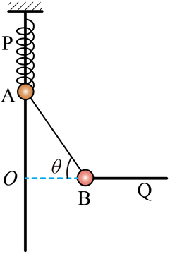

# Physics - 题目 1380

**ID**: 64b2973ca9f6447f9e9505a8c6f7c4db
**年级**: Grade 10
**难度**: Medium-Hard
**题型**: Multiple-select

## 题目
如图所示，竖直平面内固定一根竖直杆 $P$ 和水平杆 $Q$ ，两杆在同一平面内，杆 $Q$ 的延长线与杆 $P$ 交于 $O$ 点。​​​​​​​‌质量为 $2m$ 的小球 ${\rm{A}}$ 和质量为 $m$ 的小球 ${\rm{B}}$ 分别套在杆 $P$ 和杆 $Q$ 上，套在杆 $P$ 上的轻质弹簧上端固定，下端与小球 ${\rm{A}}$ 相连。小球 ${\rm{A}}$ 、 ${\rm{B}}$ 间用长为 $2L$ 的轻杆通过铰链连接。弹簧处于原长时 ${\rm{A}}{\rm{B}}$ 间的轻杆与杆 $Q$ 的夹角 $θ=53{^{\circ }}$ ，小球 ${\rm{A}}$ 从该位置由静止释放后在竖直杆上做往复运动，下降的最大距离为 $2L$ 。已知轻质弹簧的弹性势能 $E{{}_{{\rm{p}}}}=\frac {1}{2}kx{^{2}},x$ 为弹簧的形变量， $k$ 为弹簧的劲度系数。整个过程弹簧始终处在弹性限度内，不计一切摩擦，重力加速度为 $g,{\rm{s}}{\rm{i}}{\rm{n}}53{^{\circ }}=0.8$ 。则下列说法正确的是（      ）

## 解答

1. 小球A、弹簧和小球B组成的系统机械能守恒，小球A从开始释放到下降到最大距离时，由于在最低点两球的速度均为零，则根据系统机械能守恒定律有 $\frac {1}{2}k{\left({2L}\right)^{2}}=2mg\times 2L$ ，解得 $k=\frac {2mg}{L}{\rm ，A}$ 正确；小球 ${\rm{A}}$ 运动到 $O$ 点时，由关联速度知识可知小球B的速度为零，最小，B错误；轻杆与水平杆Q成θ=30°斜向左上时，设B的速度为v_{B}，A的速度为v_{A}，根据关联速度关系可知：v_{A}cos60°=v_{B}cos30°，根据系统机械能守恒定律有 $2mg\times 2L\left ({\sin 53\degree -\sin 30\degree }\right )-\frac {1}{2}k{\left({2L\sin 53\degree -2L\sin 30\degree }\right)^{2}}=\frac {1}{2}\times 2mv{{}_{{\rm{A}}}^{2}}+\frac {1}{2}mv{{}_{{\rm{B}}}^{2}}$ ，联立解得 $v{{}_{{\rm{B}}}}=\sqrt {\frac {6}{25}gL}$ ，根据动能定理可知轻杆对小球B做的功为 $W=\frac {1}{2}mv{{}_{{\rm{B}}}^{2}}=\frac {3}{25}mgL{\rm ，C}$ 正确；小球A从最高点运动到 $O$ 点的过程，小球B先加速后减速，根据 $T{\cos}θ=ma{{}_{{\rm{B}}}}$ ，当a_{B}=0时T=0，可知水平杆 $Q$ 对小球B的作用力不是始终大于 $mg{\rm ，D}$ 错误。

## 知识点

**中文**:
  - 其他连接体问题中机械能守恒定律的应用
  - 弹簧问题中机械能守恒定律的应用

**English**:
  - Other Connected Body Problems
  - Spring Problems

---
