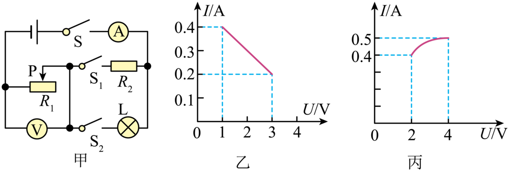

# Physics - 题目 2134

**ID**: 6cc0edc70fd54b65a4989776ba041869
**年级**: Grade 10
**难度**: Medium-Hard
**题型**: Multiple-select

## 题目
如图甲所示电路，电源电压保持不变，小灯泡L标有“ ${{4}}{\rm{V}}{{0}}{{.​​​​​​​‌}}{{5}}{\rm{A}}$ ”字样，电流表量程 $0\sim 0.6{\rm{A}}$ ，电压表程 $0\sim 3{\rm{V}}$ ，滑动变阻器 $R{{}_{1}}$ 的最大阻值 $20Ω$ ，只闭合开关S、 ${\rm{S}}{{}_{{{1}}}}$ ，调节滑动变阻器滑片P，得到电流表与电压表示数关系如图乙所示，则（      ）

## 解答

1. A．小灯泡L标有“4V 0.5A”字样，由 $P=UI$ 可知，小灯泡的额定功率 $P{{}_{额}}=U{{}_{额}}I{{}_{额}}=4{\rm{V}}\times 0.5{\rm{A}}=2{\rm{W}}{\rm ，A}$ 正确；
2. BC．只闭合开关S、S_{1}，定值电阻R_{2}和滑动变阻器R_{1}串联，电压表测量滑动变阻器R_{1}两端的电压，电流表测电路中的电流，调节滑动变阻器滑片P，得到电流表与电压表示数关系如图乙所示。由串联电路的电压特点和欧姆定律可得，电源电压 $U=U{{}_{1}}+IR{{}_{2}}$ ，在图乙中取两组数据代入公式，可得 $U=3.0{\rm{V}}+0.2{\rm{A}}\times R{{}_{2}}$ ， $U=1.0{\rm{V}}+0.4{\rm{A}}\times R{{}_{2}}$ ，联立解得 $U=5{\rm{V}}$ ， $R{{}_{2}}=10{\rm{Ω}}{\rm ，B}$ 正确，C错误；
3. D．只闭合开关S和S_{2}，灯泡L和滑动变阻器R_{1}串联，电压表测量滑动变阻器R_{1}两端的电压，电流表测电路中的电流，由串联电路的分压规律可知，当电压表示数最大为3V时，R_{1}接入电路的电阻最大，此时小灯泡两端电压 $U{{}_{{\rm{L}}}}=U-U{{}_{1大}}=5{\rm{V}}-3{\rm{V}}=2{\rm{V}}$ ，由图丙可知电路中最小电流 $I{{}_{最小}}=0.4{\rm{A}}$ ，则R_{1}接入电路的最大电阻 $R{{}_{1大}}=\frac {U{{}_{1最大}}}{I{{}_{最小}}}=\frac {3{\rm{V}}}{0.4{\rm{A}}}=7.5{\rm{Ω}}$ ，灯泡L正常工作时电流 $I{{}_{最大}}=0.5{\rm{A}}<0.6{\rm{A}}$ ，电流表安全，灯泡L正常工作时的电压为4V，此时滑动变阻器两端的电压 $U{{}_{1小}}=U-U{{}_{L额}}=5{\rm{V}}-4{\rm{V}}=1{\rm{V}}$ ，则R_{1}接入电路的最小电阻 $R{{}_{1小}}=\frac {U{{}_{1小}}}{I{{}_{最大}}}=\frac {1{\rm{V}}}{0.5{\rm{A}}}=2{\rm{Ω}}$ ，所以R_{1}允许的取值范围是 $2{\rm{Ω}}\sim 7.5{\rm{Ω}}{\rm ，D}$ 正确。选 ABD。

## 知识点

**中文**:
  - 电磁学

**English**:
  - Electromagnetism

---
